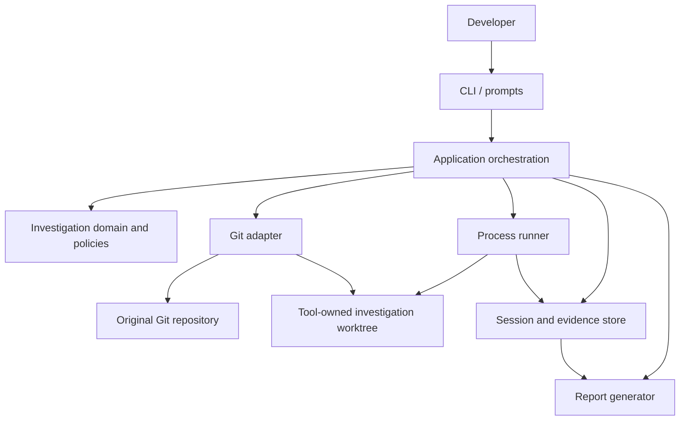

# BisectPilot — Real-World Product & Build Blueprint

**Version:** 3.0 — research update, contradictions resolved, two-agent build plan  
**Product name:** BisectPilot (CLI: `bisectpilot`). Earlier drafts called it "Git Bisect Autopilot"; one name is used throughout now.  
**Purpose:** A product specification, research review, prioritized recommendation catalogue, architecture blueprint, risk model, and implementation plan for a reliable, open-source regression investigation tool. Research review updated 19 October 2026.

> **Read first:** Section 0 lists what changed in v3. Sections 26–29 are new. Where a v3 section conflicts with an older section, the v3 section wins.

---

## 0. What changed in v3 (read this first)

v3 keeps every v2 decision that still holds and changes the plan in five ways.

### 0.1 Problems fixed in the plan itself

| # | Problem in v2 | Fix in v3 |
| --- | --- | --- |
| 1 | Two product names ("Git Bisect Autopilot", "BisectPilot") and two CLI names | One name: **BisectPilot**, CLI `bisectpilot` |
| 2 | Two different state machines (Section 3.8 and Section 20) | One state machine, Section 27, with allowed transitions |
| 3 | "Inconclusive" appears in reports but not in the classification type | Classification stays 4 kinds (good/bad/skip/abort); "inconclusive" is a **session outcome** with explicit reason codes (Section 27.3) |
| 4 | The plan assumed the regression test already exists in old commits | New **oracle overlay** design (Section 26.1). Most real regression tests are written *after* the bug is found, so they do not exist in history |
| 5 | Setup steps (`npm ci`, builds) can modify tracked files and then block Git's next checkout | Runner restores the tool-owned worktree to a clean state after every revision (Section 26.3) |
| 6 | No minimum Git version | Minimum **Git 2.36**, with reasons (Section 26.2) |
| 7 | "Kill the process tree" was stated but not designed | Concrete POSIX and Windows design (Section 26.5) |
| 8 | Work was one long sequential list | Split into **two parallel agents** with a frozen contract, file ownership and merge gates (Section 28) |

### 0.2 New research that changes decisions

- **Competitors are closer than v2 said.** FlareBisect (PyPI) already runs each candidate in its own git worktree, bisects on flake *rate*, and adds an AI root-cause note. git_bayesect does Bayesian bisection for flaky tests. So **"worktree isolation" and "AI explanation" are not differentiators.** BisectPilot's edge must be: the evidence ledger, endpoint + boundary verification, the oracle overlay, recovery, honest outcomes and reproducible reports. (Section 26.6)
- **Google's Flake Aware Culprit Finding (ICST 2023)** shows plain bisection is unreliable with flaky tests and that a Bayesian noisy binary search does better. v3 adds a **flake-rate estimate at the endpoints** in P0 and a **noisy-oracle mode** in P1 instead of only "retry N times". (Section 26.4)
- **Git internals verified:** bisect refs are per-worktree, so a BisectPilot session in its own worktree does not touch a bisect the user may be running in their main checkout. (Section 26.2)
- **cargo-bisect-rustc** contributes three proven UX ideas: automatic search for a good endpoint, a manual "prompt me" mode, and a clear warning that non-monotonic histories may return *one* of several transitions. (Section 26.6)

### 0.3 New features added

P0: oracle overlay, per-revision worktree reset, deterministic environment defaults, flake-rate check at endpoints, tamper-evident ledger, `repro.sh` generation, `safe.directory` / shallow / LFS / submodule checks in `doctor`.
P1: automatic good-endpoint discovery, manual classification mode, noisy-oracle (Bayesian) mode, per-revision toolchain detection.

Details in Section 26. The two-agent plan is Section 28; copy-paste agent briefs are Section 29.

---

### Executive recommendation

Build **BisectPilot** as a local-first, evidence-first developer tool. It should help a developer answer a specific question:

> “This behavior used to work. It fails now. Which commit most likely introduced the change, and what evidence proves that conclusion?”

Do not merely wrap `git bisect run` and stop there. Existing tools already automate bisecting, so a thin wrapper will be difficult to distinguish. The value should come from making the workflow safe, repeatable, understandable, recoverable and useful to developers who do not know Git Bisect well.

The core product promise:

1. **Reproduce:** verify that a known-good and known-bad endpoint can be distinguished by the chosen check.
2. **Investigate safely:** run the search in a dedicated worktree and preserve the developer's original checkout.
3. **Classify transparently:** record exactly which command ran, what it returned and why the revision was marked good, bad, skipped or inconclusive.
4. **Explain with evidence:** report the suspected first bad commit, its diff and the command output supporting the result.
5. **Recover:** let users inspect, resume or clean up a session without losing their work.

**Recommended architecture:** a TypeScript/Node.js modular monolith with a CLI-first interface. Use native Git Bisect as the search engine, Git worktrees to isolate checkout activity, structured command execution, local session files, and real integration tests. Do not begin with microservices, an online service, a database server, or an AI dependency.

---

## 1. The real-world problem

A developer notices a regression in the current version of a project. The bug might have appeared anywhere among dozens or hundreds of commits. Reading every commit manually is slow, and a developer may not know which intermediate versions to test.

Native Git Bisect already searches history efficiently. The unsolved product problem is the surrounding workflow:

- The regression test is not always easy to express.
- The latest and older revisions may not build in the same environment.
- Some commits are not testable.
- A test can be flaky or fail for an unrelated reason.
- Developers fear disturbing their working tree.
- A process can hang or be interrupted.
- A bare commit hash is not enough to explain the evidence.
- The investigation can be hard to reproduce on another machine.
- Existing logs can contain credentials or sensitive paths.
- Teams need a report they can attach to an issue or pull request.

BisectPilot should make the full investigation understandable and repeatable, not pretend that the search algorithm itself is new.

### 1.1 Target users and what they need

| User | Real-world job | How the tool helps |
| --- | --- | --- |
| Individual developer | Find the commit that broke a feature | Guided setup, safe worktree, automatic search and readable report |
| Open-source maintainer | Turn a vague regression report into evidence | Reproducible command, logged revisions and a GitHub-ready report |
| QA engineer | Identify when a repeatable test began failing | Test profile, endpoint verification and flaky-result handling |
| Release engineer | Find when a build stopped working | Build-regression profile with explicit build-failure semantics |
| Performance engineer | Find which revision slowed a benchmark | Later performance profile using repeated measurements and thresholds |
| Security engineer | Find when a security test or policy started failing | Later security-test profile with evidence, safe data handling and clear limits |
| Team lead | Review what the investigation actually proved | Shareable report with evidence, environment details and skipped revisions |

### 1.2 Design principle

**Git chooses the revision; the test oracle classifies it; the evidence ledger records why.**

The test oracle is the deterministic check that answers the user's question. It may be a unit test, build command, integration test, benchmark, or security regression test. The oracle should not be an LLM guess.

---

## 2. How to make it meaningfully better than a basic bisect wrapper

Several tools already automate Git Bisect locally or through hosted workflows. BisectPilot needs a useful difference. The strongest difference is a local-first investigation workflow with rigorous evidence, safer defaults, explicit classification policies and recoverable sessions.

### Product differentiators

1. **Preflight before the expensive search.** Validate Git refs, the configured commands, and the fact that the good/bad endpoints actually behave as expected.
2. **An explicit investigation profile.** Functional regression, broken build, performance regression and security-test regression each interpret results differently.
3. **Evidence ledger.** Keep a record for every examined commit: full SHA, command, exit code, duration, result, classification reason and bounded log paths.
4. **Safe-by-default execution.** Use a dedicated worktree, explicit consent before executing historical code, controlled environment variables, command timeouts, capped logs and conservative cleanup.
5. **Recoverable sessions.** A crash or Ctrl+C should not leave users wondering what state the tool created. Show the session ID, preserve its metadata, and offer a recovery/cleanup command.
6. **Honest outcomes.** Distinguish “candidate found,” “search inconclusive,” “too many commits untestable,” “the endpoints contradict each other,” and “runner failed.”
7. **A useful report.** Generate a Markdown report that includes enough evidence for another developer to reproduce the result.
8. **No cloud requirement.** The core tool should run offline after the repository and dependencies are available.

The product should not claim to prove the human-intended root cause. It identifies the first commit matching the supplied test oracle under the chosen history and execution policy.

---

## 3. Feature list, prioritised by actual usefulness

### P0 — Required for a trustworthy first release

#### 3.1 Guided investigation setup

Ask the user for:

- repository root (default to current directory)
- known-good commit, tag or ref
- known-bad commit, tag or ref
- investigation profile
- preparation command, if required
- build command, if required
- regression check command
- timeouts and output limit
- whether to run now or preview the plan first

Validate refs as commits, resolve them to full SHAs and store both the user's original ref and resolved SHA. Do not assume `HEAD` is always the known-bad endpoint.

**Real-world value:** prevents wasted runs caused by typos or incorrect assumptions.

#### 3.2 Endpoint verification

Before starting the search, run the configured oracle at both endpoints in the isolated worktree or in a controlled preflight setup. The good endpoint should pass and the bad endpoint should fail for the expected reason. If the results contradict the user's labels, stop and explain why.

Endpoint verification is not a mathematical guarantee that the test will behave consistently across all history, but it catches many misconfigured investigations early.

#### 3.3 Native Git Bisect engine

Delegate revision selection to Git. Do not build a custom binary search over commit lists for the MVP. Support native Bisect's good/bad labels and skip semantics through a runner that is outside the historical checkout.

Important runner contract:

- `0` = good/old
- `125` = skip because this revision cannot be tested
- other statuses from `1` through `127` except `125` = bad/new
- other statuses abort the native Bisect run

The runner should map internal classifications to those values explicitly. Do not forward an arbitrary test process exit code directly to Git, because a timeout, missing executable or internal error must not accidentally become evidence that the revision is bad.

#### 3.4 Isolated worktree

Create a tool-owned detached worktree for the investigation. Save its path and creation metadata in the session directory. The initial release must never run `git checkout` or `git reset --hard` against the user's original checkout.

If the user's original checkout has uncommitted work, do not copy, stash, reset or delete it. Record that it is dirty and continue only in the separate worktree if the preflight policy allows it.

A worktree reduces checkout interference; it does **not** sandbox untrusted code. Historical project scripts still run with the user's operating-system privileges unless execution is placed in a real sandbox.

#### 3.5 External runner and configuration

Store the bisect runner, session settings and evidence outside the changing source tree. Historical commits may not contain the current config, may rename scripts, or may replace the path where an in-repo runner lives.

Run a stable runner from the tool's own installation/session directory. Let the runner inspect the current `HEAD` of the investigation worktree and execute the configured test command there.

#### 3.6 Clear classification policy

Use profile-specific interpretation:

- **Functional profile:** preparation passes, build passes if configured, regression test passes => good; reproducible regression failure => bad; environment/setup failure or unrelated build failure => skip or abort according to explicit policy.
- **Build profile:** successful build => good; reproducible build failure => bad. Do not treat all build failures as irrelevant.
- **Performance profile (later):** use repeated, controlled benchmark samples and thresholds; do not classify based on one noisy measurement.
- **Security-test profile (later):** classify using a specific deterministic test or policy check, never by vague log text.

When the program cannot distinguish a real regression from an environmental issue, record “inconclusive” internally and normally map it to Git's skip status. Make it visible in the report.

#### 3.7 Evidence ledger

For each tested commit, record at minimum:

- session ID and schema version
- full commit SHA and parent SHA(s)
- timestamp and elapsed time
- profile name
- commands actually executed, each as executable plus argument array
- exit status, timeout/signal information and bounded stdout/stderr paths
- classification and human-readable reason
- environment fingerprint (OS, architecture, Git version, runtime version, optionally package-manager version)
- whether a retry changed the outcome

Do not store full environment variables, tokens or unredacted secrets. Store the names of required variables rather than their values.

#### 3.8 Session states and safe recovery

Use the single state machine defined in **Section 27** (v3 replaces the two different state lists that v2 had in this section and in Section 20).

Ctrl+C should request graceful cancellation, stop the current process tree as far as practical, save evidence and preserve recovery metadata. `resume` must verify the worktree and Git Bisect state before proceeding; it must never blindly rerun a destructive command.

#### 3.9 Reports

Produce:

- `report.md`: human-readable report suitable for an issue or pull request
- `report.json`: machine-readable result and evidence index
- per-revision logs stored as files with bounded size
- a manifest listing all generated artifacts

Report the conclusion level accurately: confirmed by oracle, probable candidate, or inconclusive. Explain skipped commits and limitations.

#### 3.10 Doctor, preview and cleanup commands

- `doctor`: verify Git/runtime prerequisites and identify an active native Bisect state if visible.
- `plan` or `start --dry-run`: resolve refs and display commands without executing historical project code.
- `status`: display state, last tested commit, elapsed time and recovery needs.
- `report`: regenerate a report from the saved evidence without rerunning tests.
- `cleanup`: only remove worktrees and directories whose ownership is confirmed by the session manifest; require confirmation if state is uncertain.

### P1 — High-value features after the core works

#### 3.11 Retry policy for flaky checks

Allow a bounded retry count. Preserve every attempt. A pass-fail-pass pattern should not be silently forced into a clean good/bad classification. After inconsistent results, classify as flaky/inconclusive and skip or pause according to policy.

Be careful not to overuse retries: they increase run time and can hide a real intermittent regression. Include the retry policy in the report.

#### 3.12 Session resume and replay

Persist the plan, resolved endpoints, classifications and Git Bisect log. On resume, compare the current worktree and repo state with the session manifest. If state differs unexpectedly, stop and explain rather than guessing.

#### 3.13 Monorepo-aware checks

Let users define a working subdirectory and a path scope. Display the scope visibly. Native Git supports path-limited Bisect, but path filters alter the search semantics, so document this and test it against fixtures.

Later, discover common workspaces (npm/pnpm/yarn, Cargo workspaces, Python package layouts) only as hints; do not automatically assume the correct test command.

#### 3.14 Environment mismatch diagnostics

Record runtime, OS and dependency-lock hashes at every revision. Flag that dependency installation, toolchain versions, environment variables or external services may differ across commits. Do not describe an environment mismatch as the root cause unless the evidence supports it.

#### 3.15 Guided test profiles

Provide templates for:

- unit-test regression
- integration-test regression
- build failure
- command output/behavior regression
- benchmark/performance regression
- static analysis/security test regression

Start with functional and build profiles only. Design types so later profiles can be added without rewriting the entire engine.

#### 3.16 Performance regression mode

This could become a real differentiator, but do it after ordinary bisect is reliable. Run a benchmark multiple times on each candidate, warm up the benchmark if needed, capture the machine/environment fingerprint, compare medians or another documented robust statistic, and require a user-defined threshold. Noise, CPU load, thermal throttling and dependency drift can all cause false positives.

#### 3.17 Export to GitHub issues / pull requests

Generate a GitHub-ready Markdown summary locally first. Later, add optional authenticated publishing. Publishing must be an explicit user action, not a side effect of running a local investigation.

#### 3.18 HTML evidence viewer

An optional local HTML report could provide a commit timeline, searchable tested revisions, expandable logs, diff links and filterable skipped revisions. Keep it local and static initially; do not start with a web server or account system.

### P2 — Useful later, but not first-release work

- Real container isolation for untrusted repositories.
- CI integration and artifact uploads.
- Test-runner adapters and project-specific setup recipes.
- Commit diff summaries and dependency-change hints.
- More advanced merge-history options.
- A history of prior investigations and comparison between runs.
- Team-shared reports or hosted execution.
- Parallel testing, if correctness and resource isolation can be maintained.
- Optional AI-generated commit explanations grounded in collected evidence.

### Explicitly out of scope at the start

- Microservices.
- Multi-tenant cloud backend.
- Mandatory AI provider or API key.
- Automatic commits, resets or pushes to the user's primary branch.
- Automatic code fixes.
- Claims that the detected commit is always the human root cause.
- Running arbitrary repository code without clear consent.

---

## 4. Recommended user experience and command design

Use a CLI name that does not pretend to replace Git itself. `bisectpilot` is a working name; check package-name availability and trademark constraints before publishing.

### Proposed command surface

```text
bisectpilot doctor
bisectpilot init
bisectpilot plan --good <ref> --bad <ref>
bisectpilot start --good <ref> --bad <ref>
bisectpilot status <session-id>
bisectpilot resume <session-id>
bisectpilot report <session-id>
bisectpilot cleanup <session-id>
bisectpilot list
```

Example walkthrough:

```bash
cd my-project
bisectpilot doctor
bisectpilot init
bisectpilot plan --good v1.8.0 --bad HEAD
bisectpilot start --good v1.8.0 --bad HEAD
```

`init` should create an example project config and ask the developer what behavior proves that the issue is present. It should not automatically run package scripts just because it found them.

The output should be compact, readable and honest:

```text
BisectPilot
Repository: /work/my-project
Profile: functional regression
Good endpoint: v1.8.0 -> 4da12f...
Bad endpoint: HEAD -> a812ee...
Test command: npm test -- --runInBand

Preflight:
  [pass] Git repository and endpoints
  [pass] Good endpoint meets the test oracle
  [pass] Bad endpoint reproduces the failure

Isolation:
  Worktree: ~/.cache/bisectpilot/sessions/01J.../worktree
  Original checkout: not modified by the checkout workflow

Proceed to execute historical project code? [y/N]
```

That transcript is an illustrative interface, not output from a working build.

### CLI interaction rules

- Support non-interactive mode for scripts and CI.
- Show the exact resolved commit SHAs, not only friendly tags.
- Preview every command before first execution.
- Use meaningful exit codes for the CLI itself, distinct from the internal `git bisect run` runner code.
- Ensure Ctrl+C is handled gracefully.
- Give corrective next steps when Git, the test command or the worktree fails.
- Do not print secrets from config or environment.

---

## 5. Architecture: modular monolith, not microservices

### High-level view



### Boundaries and responsibilities

| Module | Responsibility | Must not do |
| --- | --- | --- |
| `cli` | Parse arguments, prompts, progress and user-facing errors | Implement Git logic or classification rules |
| `application` | Coordinate preflight, setup, run, resume and cleanup | Construct shell commands by string concatenation |
| `domain` | Session states, classification policy, result types and invariants | Read the filesystem or invoke Git directly |
| `adapters/git` | Validate refs, create/list/remove worktrees, run Bisect, read commit metadata | Decide whether a test failure means bad without the profile policy |
| `adapters/process` | Spawn configured executable with args, timeout, bounded logs and environment policy | Silently inherit all secrets or hide exit codes |
| `adapters/storage` | Persist versioned session and evidence documents atomically | Persist credential values or assume a session file is always valid |
| `adapters/reports` | Render saved evidence to Markdown and JSON | Invent causality or alter recorded test results |
| `runner` | Stable executable called by `git bisect run`; test current checkout, record evidence, map classification to Git status | Live inside the changing commit tree |

For the first release, the runner can be a small internal module invoked through the installed Node executable. Its location and session configuration must remain stable throughout the bisect.

### Proposed source tree

```text
git-bisectpilotpilot/
├── AGENTS.md
├── README.md
├── LICENSE
├── package.json
├── tsconfig.json
├── vitest.config.ts
├── docs/
│   ├── architecture.md
│   ├── safety-model.md
│   ├── supported-profiles.md
│   └── demo-guide.md
├── src/
│   ├── cli/
│   │   ├── index.ts
│   │   └── commands/
│   │       ├── doctor.ts
│   │       ├── init.ts
│   │       ├── plan.ts
│   │       ├── start.ts
│   │       ├── status.ts
│   │       ├── resume.ts
│   │       ├── report.ts
│   │       └── cleanup.ts
│   ├── application/
│   │   ├── preflight.ts
│   │   ├── run-investigation.ts
│   │   ├── session-service.ts
│   │   └── recovery-service.ts
│   ├── domain/
│   │   ├── session.ts
│   │   ├── classification.ts
│   │   ├── profile.ts
│   │   └── errors.ts
│   ├── adapters/
│   │   ├── git/
│   │   │   ├── git-client.ts
│   │   │   ├── ref-validator.ts
│   │   │   ├── worktree-manager.ts
│   │   │   └── bisect-controller.ts
│   │   ├── process/
│   │   │   ├── process-runner.ts
│   │   │   ├── output-capture.ts
│   │   │   └── environment-policy.ts
│   │   ├── storage/
│   │   │   ├── session-store.ts
│   │   │   └── evidence-store.ts
│   │   └── reports/
│   │       ├── markdown.ts
│   │       └── json.ts
│   ├── runner/
│   │   └── bisect-runner.ts
│   └── index.ts
├── tests/
│   ├── unit/
│   ├── integration/
│   └── e2e/
└── examples/
    └── intentionally-broken-repo/
```

Treat this as a target map, not a demand to create every file on day one. Begin with the smallest vertical slice and extract modules when their boundaries become clear.

### Why this is not microservices

The product runs on a developer's machine, uses local Git repositories and performs a sequential investigation. Network services, distributed locks, message queues and service-to-service authentication would introduce operational burden without solving the main problem. A modular monolith gives clean boundaries without deployment complexity.

---

## 6. Runtime behavior and result classification

### 6.1 Investigation sequence

1. Resolve the repo root and verify that it is a Git repository.
2. Check Git version and existing Bisect state in the target worktree.
3. Resolve good/bad refs to full commit hashes and verify they are valid commits.
4. Inspect working-tree state and record whether the original checkout is dirty.
5. Create a unique session directory and detached worktree.
6. Save the session manifest before executing project code.
7. Run endpoint checks and verify the oracle distinguishes them as expected.
8. Display the final plan and ask for consent to run historical code.
9. Start native Git Bisect in the session worktree.
10. Invoke the stable runner for each selected revision.
11. Record every classification and result as an append-only evidence event.
12. Parse the final Bisect result and verify that the candidate matches recorded evidence.
13. Reset Bisect state only in the session worktree, then clean up if safe.
14. Generate Markdown/JSON reports and clearly state whether cleanup succeeded.

The runner must be located outside the checked-out revision. Git's own documentation similarly warns that keeping the bisect script outside the repository is safer because it avoids interaction with changing checkouts.

### 6.2 Classification policy

Use a typed internal classification:

```ts
export type Classification =
  | { kind: "good"; reason: string }
  | { kind: "bad"; reason: string }
  | { kind: "skip"; reason: string }
  | { kind: "abort"; reason: string };
```

The reason should be machine-derived and human-readable, for example:

- `good`: setup and required build succeeded; the selected regression check passed.
- `bad`: setup/build prerequisites succeeded; the configured regression check failed with an expected test failure.
- `skip`: this revision could not be evaluated because dependencies did not install or the toolchain was unavailable.
- `abort`: runner configuration is invalid, an executable is missing, internal state is corrupt, or the process was cancelled in a way that prevents continuation.

Do not identify “expected test failure” only by searching for the word `Error` in stdout. Prefer a specific test command and its exit status, with separate preflight/setup/build checks.

### 6.3 Translate internal results to native Git Bisect exit codes

The wrapper process, not the test command itself, returns the exit code consumed by Git:

| Internal classification | Runner exit code | Meaning to Git |
| --- | ---: | --- |
| `good` | `0` | Good/old |
| `bad` | `1` | Bad/new |
| `skip` | `125` | This revision cannot be tested; skip |
| `abort` | `128` (or another documented abort status) | Stop the bisect run |

**v3 additions:** the runner must never emit `126` or `127`. Since Git 2.36, `git bisect run` re-tests the known-good revision when it sees those codes and aborts if they repeat, because they usually mean "script not executable / command not found". BisectPilot should catch those cases itself in preflight (Section 26.2) instead of relying on Git's fallback. Use `128` for abort.

Choose the mapping in one tested function. Never pass raw test exit statuses directly to Git. See the official Bisect `run` contract for the reason: status `125` has special skip meaning; other `1–127` statuses classify a revision as bad; other values abort the run.

### 6.4 Setup and dependency behavior

Historical revisions can have different package manifests, lockfiles or toolchains. A one-time install may be incorrect if dependencies changed across the history.

For MVP:

- Allow an explicit `prepare` command.
- Run it for each revision by default when it is required to test that revision.
- Make a prepare failure a skip or abort according to the chosen profile, not automatically a bad commit.
- Capture preparation output separately from the regression-test output.
- Set a sensible timeout and document the cost.

Later, dependency caches may be keyed by OS, runtime version, package manager and lockfile digest. Never reuse a dependency directory if its key is not a close match to the current revision's dependency inputs.

### 6.5 Merge history and skipped commits

Not every repository has a straight line of commits. Merge commits, multiple good boundaries, a shallow clone, or a large range of untestable revisions may complicate interpretation. Native Git has options such as first-parent search, multiple known-good commits, path limits, skip ranges and bisect log/replay. Make advanced options explicit rather than silently changing the search's semantics.

If too many nearby revisions are skipped, Git may be unable to identify one exact boundary. Report the possible range and skipped commits instead of pretending a single commit was proved.

---

## 7. Configuration and data model

### 7.1 Example config

A structured command object helps avoid shell-string assembly in the tool itself:

```json
{
  "schemaVersion": 1,
  "profile": "functional",
  "workingDirectory": ".",
  "prepare": {
    "command": "npm",
    "args": ["ci"],
    "timeoutMs": 300000
  },
  "build": {
    "command": "npm",
    "args": ["run", "build"],
    "timeoutMs": 180000,
    "failurePolicy": "skip"
  },
  "test": {
    "command": "npm",
    "args": ["test", "--", "--runInBand"],
    "timeoutMs": 180000
  },
  "execution": {
    "maxOutputBytesPerCommand": 1000000,
    "maxRetries": 0,
    "confirmBeforeExecutingCode": true
  }
}
```

This is illustrative. The test command syntax depends on the project's chosen test runner. `prepare` and `build` are optional if the project does not need them.

The tool must validate this config at load time and provide clear errors. Keep user configuration and runner implementation outside the historical checkout so old commits cannot replace the runner or delete its settings.

### 7.2 Suggested session shape

```ts
interface InvestigationSessionV1 {
  schemaVersion: 1;
  id: string;
  createdAt: string;
  updatedAt: string;
  status:
    | "created"
    | "preflight"
    | "running"
    | "paused"
    | "completed"
    | "inconclusive"
    | "failed"
    | "cancelled"
    | "needs-recovery"
    | "cleaned-up";
  repository: {
    rootPath: string;
    commonGitDir: string;
    originalHead: string | null;
    originalWasDirty: boolean;
    worktreePath: string;
    createdByTool: true;
  };
  bounds: {
    goodInputRef: string;
    goodSha: string;
    badInputRef: string;
    badSha: string;
  };
  profile: "functional" | "build";
  configPath: string;
  runnerVersion: string;
  result?: {
    candidateSha?: string;
    outcome: "candidate-found" | "inconclusive" | "failed";
    explanation: string;
  };
}
```

Keep detailed command results in a separate append-only JSONL file. Include schema versions so future releases can migrate older sessions safely. Treat session files as untrusted input and validate them before resuming.

Do not store the complete inherited environment or secret values. Save a safe fingerprint and the names of required environment variables only.

### 7.3 Atomic writes and recovery

- Write updates to a temporary file, flush/close it, then rename into place where supported.
- Append one JSONL event per completed step.
- Include a generated session ID and a manifest of tool-owned paths.
- On startup, find stale sessions and tell the user how to inspect/recover them. Do not automatically delete them.
- If Git cleanup fails, preserve the manifest and show the exact worktree path and safe manual recovery instructions.

---

## 8. Process execution and security model

This is the most important engineering area after correct classification. The tool runs builds and tests from historical code, which can execute arbitrary scripts with the user's permissions.

### 8.1 Safe subprocess design

Use Node's `child_process.spawn()` or `execFile()` with the executable and argument list separated. Set `shell: false` unless there is a deliberate, documented need for shell syntax. Do not concatenate user input into a shell command. Node's official documentation warns that shell metacharacters in unsanitized input can trigger arbitrary command execution.

Example shape:

```ts
spawn(config.command, config.args, {
  cwd: worktreePath,
  shell: false,
  env: buildRestrictedEnvironment(config),
  stdio: ["ignore", "pipe", "pipe"],
  timeout: config.timeoutMs
});
```

This code is a design illustration; production code must also handle spawn errors, stream capture, process termination, close events, signals, timeout races and child-process trees.

Important nuance: a command such as `npm test` will itself run the package's scripts. Avoiding shell interpolation in our launcher does not make the target repository trustworthy. Explicit consent and a real sandbox for hostile repositories remain important.

### 8.2 Environment policy

Do not pass every parent process environment variable through by default. Define a minimal baseline that includes PATH and the variables needed by the process, then add project-specific variables by explicit allowlist. The design must account for platform requirements and not make the tool unusable by stripping required runtime paths.

- Never print secret values into logs.
- Do not expose cloud credentials, registry tokens or production secrets to historical scripts by default.
- Let users opt in to specific environment-variable names.
- Redact likely tokens, authorization headers, passwords and private keys from report output.
- Explain that redaction is best-effort and is not a substitute for secret-free test environments.

### 8.3 Resource limits

- Per-step timeout.
- Maximum output bytes per command and per session.
- Maximum number of revisions or maximum total run duration.
- Bounded retries.
- Cancellation support.
- Child-process-tree cleanup where the platform allows it.
- Disk-usage awareness for large logs and worktrees.

### 8.4 Worktree cleanup rules

Only remove the exact path recorded as a tool-created worktree in a valid session manifest. Resolve paths, check ownership metadata and verify they are inside the intended session directory before deletion. Do not use broad globs, string-prefix checks alone, or `rm -rf` with an unchecked path.

Never invoke destructive Git commands in the user's original checkout as a cleanup shortcut. If state is unclear, prefer leaving a recoverable worktree and explaining the next safe action over forcibly deleting it.

### 8.5 Security levels

**MVP safety level:** separate worktree, explicit consent, no shell-string interpolation by our launcher, limited environment, timeouts, capped logs, session-owned cleanup and no cloud upload.

**Future hardened mode:** container/VM execution with controlled filesystem mounts, no host credentials, network restrictions where feasible and resource caps. Containers are not automatically a perfect security boundary; document the exact threat model and configuration.

---

## 9. Testing strategy: prove the tool discovers the right commit

A real integration test using disposable repositories is mandatory. Unit tests cannot prove that Git Bisect, checkout transitions and cleanup all work together.

### 9.1 Build deterministic fixture repositories

Create a test helper that runs `git init`, creates a sequence of commits and adds a small regression test. For example:

- commit A: function returns `true`; regression test passes
- commits B and C: unrelated changes; test still passes
- commit D: function changes and test fails
- commits E through J: unrelated changes; test remains failing

The expected result is commit D. The automated integration test must compare the discovered full SHA with the expected SHA.

Create separate fixtures for a build failure, a flaky test, an untestable revision, a missing executable, a timeout, a test that behaves differently at the two endpoints, dirty original files and interrupted cleanup.

### 9.2 Test categories

#### Unit tests

- Config schema validation.
- Commit/ref normalization.
- Classification policy for each profile.
- Mapping classifications to Git runner exit codes.
- Session state transitions.
- Safe log redaction.
- Output truncation and timeout classification.
- Report rendering from a fixed evidence fixture.
- Cleanup path validation.

#### Integration tests

- Create and remove a real linked worktree.
- Verify current `HEAD` in the test worktree changes while original `HEAD` stays where it was.
- Run actual `git bisect run` through the stable runner.
- Verify the injected first bad commit is discovered.
- Verify exit code 125 skips a revision and that skip evidence is saved.
- Verify abort statuses stop the search.
- Verify a cancelled run leaves enough metadata for recovery.

#### End-to-end tests

Run the CLI as a user would:

1. Create a temporary repo.
2. Run `doctor`.
3. Run `init` with a fixture config.
4. Run `plan` and inspect resolved refs.
5. Run the bisect.
6. Check the generated report.
7. Verify the original checkout and test files remain unchanged.
8. Run cleanup and confirm that only tool-owned resources were removed.

### 9.3 Acceptance criteria

Do not declare version one done until:

- A deterministic fixture finds the exact injected regression commit.
- Both endpoints are checked before the search when endpoint validation is enabled.
- An inconsistent endpoint pair is rejected with a clear explanation.
- A timeout is not mislabeled as proof of a regression.
- Unbuildable revisions follow the selected skip/abort policy.
- Logs are capped and redaction tests pass.
- The original working directory and uncommitted user changes are preserved.
- A failed cleanup leaves useful recovery instructions.
- `report.md` and `report.json` contain matching conclusions and evidence.
- A fresh clone can install, run tests and execute the documented demo.

---

## 10. Development roadmap and milestones

### Milestone 0 — Repository and spec (first hour)

- Inspect the environment and current repository.
- Create `AGENTS.md`, the README outline and architecture notes.
- Initialize TypeScript, package scripts, test runner and strict compiler settings.
- Add a tiny test fixture generator for temporary Git repositories.
- Keep the first commit small and reproducible.

**Exit condition:** `npm test` and `npm run typecheck` run successfully on the empty scaffold.

### Milestone 1 — Git adapter and safe worktree lifecycle

Implement:

- Git availability and version check.
- Repository root/common Git directory detection.
- Ref verification and full-SHA resolution.
- Original worktree/HEAD/status snapshot.
- Tool-owned detached worktree creation.
- Worktree listing and safe cleanup.

**Exit condition:** integration tests prove that worktree creation and cleanup do not move or modify the original checkout.

### Milestone 2 — Minimal regression runner

Implement one deterministic fixture and a stable runner outside the checked-out source tree. The runner reads the current commit SHA, runs a fixed test command, records result evidence and maps the outcome to Git's exit contract.

**Exit condition:** a single test fixture discovers the injected commit with real `git bisect run`.

Do not move ahead until this works reliably.

### Milestone 3 — Endpoint preflight and profiles

Add good/bad endpoint checks and initial profiles for functional regressions and build failures. Keep profile-specific result policy separate from the process runner.

**Exit condition:** tests cover endpoints that agree, endpoints that contradict, and revisions that cannot be tested.

### Milestone 4 — Session persistence, reporting and cancellation

Add versioned session manifests, JSONL evidence, Markdown/JSON reports, timeouts, output caps, Ctrl+C handling and recovery state.

**Exit condition:** a deliberately interrupted fixture can be inspected after restart, and the tool does not silently discard evidence.

### Milestone 5 — Usable CLI and documentation

Add `doctor`, `init`, `plan`, `start`, `status`, `resume`, `report`, `cleanup` and `list`. Build a no-network, three-minute demonstration.

**Exit condition:** a new developer can follow the README and reproduce the demo on a clean checkout.

### Milestone 6 — Real-world beta

Test on several small open-source repositories with different test runners and histories. Record where setup fails, how often revisions are skipped and what reports confuse users. Publish limitations and ask maintainers for feedback.

**Exit condition:** stable evidence and recovery behavior matter more than the number of repositories supported.

---

## 11. One-day build plan versus a real product plan

A reliable open-source developer tool needs more than a single hackathon day. Keep the ambitions separate.

### One-day demonstration scope (8–12 focused hours)

1. TypeScript CLI scaffold.
2. Disposable fixture repository with a single planted functional regression.
3. Git worktree creation and cleanup.
4. Native `git bisect run` with an external runner.
5. Basic per-commit JSONL evidence.
6. Markdown result report.
7. One end-to-end test proving the correct SHA is discovered.
8. Clear README and short demo.

Avoid resume, HTML visualizations, GitHub publishing, generalized monorepo detection, performance mode and container security in the one-day build unless the above is already robust.

### Real-world v1.0 scope

Add endpoint verification, session recovery, safe process handling, environment control, comprehensive tests, versioned storage, redaction, detailed reports, clean-install documentation and cross-platform behavior. This is what turns a hackathon prototype into a tool other developers can trust.

---

## 12. How to make it useful across real-world scenarios

| Scenario | Profile/check | Specific feature needed | Important caveat |
| --- | --- | --- | --- |
| Login or feature broke | Functional | Reproducible unit/integration test | The test must actually reflect the user-visible bug |
| Build started failing | Build | Treat build failure as the bad signal | Distinguish a compiler/toolchain issue from code regression where possible |
| A library update broke tests | Functional / dependency | Setup command and per-revision lockfile-aware environment | Old manifests may require different runtime versions |
| API latency increased | Performance, later | Repeated benchmarks, stable environment, threshold | Noisy measurements can create false positives |
| Static security check regressed | Security-test, later | Deterministic scan/test and saved scanner version | Scanner database/version drift must be recorded |
| Monorepo package broke | Scoped functional | Package subdirectory and path scope | Scope changes the search space and must be reported |
| Mid-search CI runner crashed | Recovery | Persisted state and evidence | Resume only after verifying Git and worktree state |
| Commit cannot build | Skip policy | Record skip reason and surrounding boundaries | Many skipped commits may prevent a unique answer |
| Intermittent test failure | Flaky-test handling | Bounded retries and inconsistent-result state | Retries are evidence, not a guarantee of determinism |
| Maintainer needs an issue report | Reporting | Repro command, commit links, diff and logs | Redact local secrets and machine-specific private paths |
| Developer suspects bad merge | Merge-history option, later | Explicit first-parent or merge strategy | Must not silently change search semantics |
| Bug appears only in one environment | Environment profile, later | Runtime/OS/dependency fingerprint | Local reproduction may still differ from production |

### A particularly useful later feature: evidence confidence, not a fake certainty score

Avoid displaying a made-up “97% confident” score. Instead show transparent evidence indicators:

- endpoints reproduced successfully or not
- number of revisions classified
- number of revisions skipped
- any inconsistent/retried results
- environment fingerprint stable or changed
- regression test exit status observed
- candidate diff available
- result reproducible in a second run or not

A human can then judge the strength of the result based on visible facts.

---

## 13. Suggested skills and rules for the permitted coding agent

Use one always-on project rule file and several focused skills. Skill names below are proposed project instructions, not claims that a preexisting public skill with that exact name exists.

### Root `AGENTS.md`

Include rules such as:

- Inspect before changing.
- Understand callers and dependencies.
- Reuse existing code and keep the change small but complete.
- Do not add abstractions, dependencies or services without a real need.
- Keep TypeScript strict and avoid unsafe casts.
- Do not claim tests passed unless they were executed and their actual result is known.
- Never run destructive Git operations in the user's original worktree.
- Keep runner/config/evidence outside historical checkouts.
- Treat repository code as untrusted; require consent and use controlled process execution.
- Record every classification with evidence.
- Update tests, docs and architecture notes when behavior changes.
- Follow Ponytail FULL engineering discipline if it is allowed by the event's rules.

### Focused skill directory

```text
skills/
├── git-bisect-domain/SKILL.md
├── secure-process-execution/SKILL.md
├── git-worktree-recovery/SKILL.md
├── typescript-cli-engineering/SKILL.md
├── regression-integration-testing/SKILL.md
└── open-source-release/SKILL.md
```

#### What each skill should teach

**Git Bisect domain:** endpoint semantics, exit-code mapping, skipped revisions, merge histories, multiple known-good commits, interpretation of “first bad” and when the result is inconclusive.

**Secure process execution:** structured args, `shell: false`, env allowlists, secrets, timeouts, output caps, process trees and explicit consent.

**Git worktree recovery:** verify original state, create only tool-owned paths, remove only owned worktrees, preserve recovery manifests and avoid destructive operations on the primary checkout.

**TypeScript CLI engineering:** clear commands, config validation, typed errors, stable exit codes, prompts, non-interactive mode and cross-platform paths.

**Regression integration testing:** temporary local repositories, known injected regression commits, failure fixtures, timeouts, interrupted runs, evidence assertions and cleanup verification.

**Open-source release:** README, installation, supported platforms, example config, limitations, license, changelog, GitHub Actions and reproducible release.

### Recommended agent workflow

For every meaningful feature:

1. Inspect existing code and relevant docs.
2. State the smallest implementation plan.
3. Implement one complete vertical slice.
4. Run focused tests, then typecheck/lint as appropriate.
5. Inspect the diff for accidental changes or secrets.
6. Update docs and report exactly what passed or failed.

The agent should not generate the entire repository in one giant response. Let tests and observed behavior guide each next step.

---

## 14. Definition of done for a credible open-source launch

### Functionality

- [ ] Can find a deterministic regression in a temporary Git repository.
- [ ] Validates the good and bad endpoints.
- [ ] Records each revision's result and reason.
- [ ] Handles untestable commits correctly.
- [ ] Has timeouts and output limits.
- [ ] Supports cancellation and safe recovery.
- [ ] Generates Markdown and JSON reports.

### Safety

- [ ] Never checks out or resets the original worktree during an investigation.
- [ ] Only deletes session-owned paths after validation.
- [ ] Requires clear consent before executing historical code.
- [ ] Does not unnecessarily inherit or log secrets.
- [ ] Correctly distinguishes timeout/internal error from a bad revision.
- [ ] Documents that a worktree is not a security sandbox.

### Engineering quality

- [ ] TypeScript strict mode and typecheck pass.
- [ ] Unit tests cover classification and state transitions.
- [ ] Integration tests use real temporary Git repos.
- [ ] End-to-end demo can run from a clean checkout.
- [ ] Tests verify the exact discovered SHA.
- [ ] Reports contain only recorded evidence, not fabricated claims.
- [ ] Session formats are versioned and validated.

### Open-source readiness

- [ ] README states the problem, prerequisites, installation and usage.
- [ ] License has been chosen intentionally.
- [ ] Security model and limitations are documented.
- [ ] Contribution guidelines and issue templates exist if useful.
- [ ] CI runs typecheck and tests.
- [ ] Demo is reproducible offline after dependencies are installed.
- [ ] Known limitations are published honestly.

---

## 15. Recommended public positioning

**One-sentence pitch:**

> BisectPilot is a local-first, evidence-driven regression investigator that finds the earliest commit matching a reproducible failure while keeping the developer's original working tree untouched by its checkout workflow.

**README opening:**

> Stop guessing which commit broke your project. Define a reproducible check, verify the good and bad endpoints, and let native Git Bisect narrow the history. BisectPilot records every decision, explains skipped revisions, produces a shareable report and keeps the investigation in a dedicated worktree.

Avoid saying “AI finds the root cause automatically.” The core product is a deterministic investigation workflow. An optional AI summary can be added later only if it cites actual commit diffs and recorded test evidence and is clearly labeled as an interpretation.

### What makes the demo memorable

Use an intentionally broken fixture repo whose injected regression commit is known to the test author but not to the running tool. Run the actual search, reveal the discovered SHA, open the corresponding diff, show the evidence record and verify that the user's original checkout stayed unchanged. The strongest demo is a correct result backed by observable proof, not an animated progress bar.

---

## 16. External references to use during implementation

1. **Git Bisect official documentation** — automated runs, known-good/known-bad endpoints, skip status, logs/replay and alternate terms: <https://git-scm.com/docs/git-bisect/>
2. **Git worktree official documentation** — linked worktrees, detached worktrees and lifecycle: <https://git-scm.com/docs/git-worktree.html>
3. **Node.js child process official documentation** — `spawn`, argument arrays, environment handling, timeouts and shell-injection warnings: <https://nodejs.org/api/child_process.html>
4. **Existing hosted bisect product reference** — Bisect documentation, useful for understanding the baseline market and avoiding a thin-wrapper product: <https://bisect.sh/docs>
5. **Existing parallel bisect project reference** — `git-pisect`, useful for understanding that parallel regression search is an existing approach, not a novel feature by itself: <https://github.com/hoelzro/git-pisect>

Use the latest official Git and Node.js documentation when implementing version-specific behavior. This blueprint is a design plan; it is not a claim that the product has already been implemented or tested.

---

## Final build order

If beginning today, implement in this exact order:

1. Create the project scaffold and one deterministic fixture repository.
2. Add Git ref validation.
3. Add the tool-owned worktree manager and prove that the original checkout is preserved.
4. Add an external runner and get one real native `git bisect run` to find a planted regression.
5. Add internal classification-to-exit-code mapping and evidence logging.
6. Add endpoint preflight, timeout handling and skip policy.
7. Add sessions, recovery and safe cleanup.
8. Add Markdown/JSON reports.
9. Add the CLI polish and README.
10. Only after reliability is demonstrated, consider flaky retries, monorepo support, performance mode, HTML viewer or CI integrations.

**The guiding rule:** never make the tool more visually impressive at the expense of correct classification, safe recovery or trustworthy evidence.

---

## 17. Research review added in version 2.0

### 17.1 Scope and honesty of this review

This review searches across the primary Git and Node.js documentation, existing regression-bisection tools, security guidance, and relevant software-engineering research on regression localization, flaky tests, change impact, delta debugging, and LLM-assisted fault localization. It is a focused research review, **not a claim that every website or every paper in existence has been read**. The web is not a finite, enumerable set, some publisher pages expose only abstracts, and results are constrained by publication access. Where full accessible text is available, findings were checked against it; where it is not, the bibliography explicitly identifies the paper or abstract as the source.

Date of review: 19 October 2026. Links below should be checked again during implementation because online documentation and project capabilities can change.

### 17.2 Research-derived conclusions that affect the product

1. **The algorithm is not the product.** Git already provides native bisection. Chromium and Mozilla have dedicated build-regression tools, and Bisect.sh has a hosted GitHub workflow and local CLI. A new tool must provide a clearly useful workflow, not merely repackage a command.
2. **Endpoint verification is a first-class feature.** Chromium's own `bisect-builds.py` has a `--verify-range` option precisely because a wrong range or mismatched reproduction environment can make the entire search useless. BisectPilot should verify both boundary revisions before spending time testing the middle.
3. **A regression result is only as good as its test oracle.** Research on using regression tests to identify bug-introducing commits calls out two major obstacles to testing historic snapshots: whether the snapshot can be built and whether the test can run in that snapshot. The product must report these as compatibility limits, not conceal them.
4. **Flaky tests invalidate naive binary classification.** A multivocal review of test flakiness studied a broad body of academic and practitioner literature, and other work shows that rerunning tests can be expensive. Use bounded, configurable retries only when a result is suspect, preserve all attempts, and stop with an inconclusive outcome when behavior remains inconsistent.
5. **A skipped revision can make the exact culprit unknowable.** Git explicitly documents that a sequence of skipped commits can leave several possible first-bad candidates. Reports must preserve ranges and state uncertainty; never force a single SHA when Git cannot prove one.
6. **History is a graph, not always a straight line.** Merge commits, branch topology, first-parent choices, commits that are unbuildable, and multiple changes that affect the same behavior require explicit product decisions. Never silently reinterpret the history.
7. **Heuristic blame is not proof.** SZZ-family algorithms can be useful for candidate ranking, but empirical research documents failure modes such as tangled changes and ghost commits. A commit diff, author, or blame result is supporting context; the test oracle and bisection evidence are the primary basis for the finding.
8. **AI can help explain but must not decide.** Research on LLM fault localization finds meaningful sensitivity to the size and type of supplied context. Later, an optional explanation layer can summarize a narrowed diff with links to evidence, but deterministic command results must decide good/bad/skip.
9. **Delta debugging is a separate, potentially valuable extension.** Once a regression is identified, a future extension could minimize a reproducing input, request, or test case. It should not be mixed into the first release's critical bisect path.
10. **Do not optimize test selection prematurely.** Research on regression-test selection documents trade-offs and varying empirical results across techniques. First build a trustworthy full-oracle path; then consider change-impact-informed test selection, always labeling it as an optimization and keeping a safe full-test fallback.

### 17.3 Existing tools and what they imply for differentiation

#### Native Git Bisect

Official documentation describes a binary search over history and the automated `git bisect run` protocol. Its runner should return `0` when the current revision is good, `1`–`127` excluding `125` when bad, and `125` to skip a revision that cannot be tested; other exit statuses abort the run. Therefore, a wrapper must not simply pass arbitrary package/test failures through as raw exit codes: a missing executable, runner bug, cancellation or infrastructure problem must not accidentally become “bad commit.” Validate the command before the search and use a small external adapter script that maps only well-understood outcomes to Git's protocol.

Reference: <https://git-scm.com/docs/git-bisect/>

#### Git Worktree

Git worktrees allow multiple working trees attached to one repository and are intended for cases where a developer wants to work elsewhere without disturbing an in-progress working tree. Worktrees are **checkout isolation, not a security boundary**. They share repository storage and some repository-level information. The manager must create a unique tool-owned path, keep an ownership record, inspect it before cleanup, and never delete a path solely because a session file says it exists.

Reference: <https://git-scm.com/docs/git-worktree.html>

#### Chromium `bisect-builds.py`

Chromium documents a workflow that finds a regression across archived builds, can drive automatic checks, and offers endpoint validation through `--verify-range`. It also warns that the revision range and the environment affect whether a result is useful. Product lesson: validate endpoints early, retain environment/revision metadata, and make the check reproducible.

Reference: <https://www.chromium.org/developers/bisect-builds-py/>

#### Mozilla `mozregression`

Mozilla's `mozregression` supports automatic bisection using a user-supplied command and variables pointing to the build being tested. This illustrates the importance of a controlled regression oracle and application-specific adapters. Product lesson: the runner should support profiles/adapters while keeping the core engine generic.

References: <https://mozilla.github.io/mozregression/documentation/> and <https://mozilla.github.io/mozregression/documentation/automatic-bisection.html>

#### Bisect.sh

Bisect.sh documents a GitHub App flow in which a user can trigger a bisect from an issue and a local CLI workflow. Product lesson: GitHub issue/PR integrations and remote workflows already exist in the ecosystem; do not market them as novel by themselves. Differentiate on local-first operation, safe execution, evidence provenance, recovery, clear outcomes and a framework that can be audited.

Reference: <https://bisect.sh/docs>

#### Product differentiation statement

Recommended positioning:

> **BisectPilot is a local-first, evidence-first regression investigation workbench that validates the test oracle, safely orchestrates native Git Bisect, records the reasoning behind every classification, survives interruptions, and produces a reproducible handoff report.**

Do not claim it is the first automated bisect tool or that it always finds the true root cause.

---

## 18. Research findings and how they change the roadmap

### 18.1 Regression bisection assumes a usable test oracle

Git's built-in search uses the answers good/bad/skip to reduce a search space. This works best when the tested behavior is meaningfully consistent over the range. In real repositories, the bug may have been introduced and then fixed, introduced multiple times, or emerge only due to a combination of changes. A binary search may still identify a transition but cannot prove that the one candidate is the sole root cause under non-monotonic behavior.

**Recommendation:** call the outcome “suspected first bad commit for this oracle and history range.” Keep the user-provided phenomenon, command, endpoints, and limitations in the report. If the final boundary is ambiguous, report candidates/range rather than manufacture certainty.

Add a final boundary confirmation step after Git reports the result:

1. Re-run the oracle on the candidate and its relevant parent where possible.
2. Apply the configured retry policy if either result is unstable.
3. Confirm that the results align with the reported boundary.
4. If they do not, mark the investigation inconsistent and offer a revised oracle or manual review.

The final check is evidence that the found boundary matches the oracle; it is not a proof that the underlying human-defined bug has no other cause.

Reference: <https://git-scm.com/docs/git-bisect/>

### 18.2 Historical tests do not always transplant to old snapshots

A 2024 paper in *Empirical Software Engineering*, “Hunting bugs: Towards an automated approach to identifying which change caused a bug through regression testing,” analyzes whether regression tests can be used on historical snapshots. It explicitly discusses “transplantability” and the problems of older revisions not compiling or tests not running correctly. This backs a central requirement: the same oracle may not be runnable at every historical commit.

**Recommendations:**

- Let users define setup, build and test stages separately.
- Allow a project-specific setup adapter when older snapshots need special instructions.
- Separate “code failed the intended regression test” from “could not install/build/run the test.”
- Preserve historical dependency installation output and runtime versions.
- Include the non-testable revision count and percentage in the report.
- If too many revisions are skipped, stop with “insufficient evidence” instead of overclaiming.

Reference: <https://link.springer.com/article/10.1007/s10664-024-10479-z>

### 18.3 Flakiness is a product problem, not a cosmetic edge case

The multivocal review by Rasheed, Tahir, Dietrich, Hashemi and Zhang surveys research and practitioner writing about flaky tests and organizes the topic around causes, detection, impact and responses. The authors describe a wide body of reviewed material; the journal version analyzes 200 focused articles/posts from an initial pool of 560, including 109 academic and 91 practitioner sources. A separate CANNIER study evaluated 89,668 tests across 30 Python projects and investigated the cost of rerun-based detection.

**Recommendations:**

- Record every retry as a separate attempt, not an overwritten result.
- Retry only under a bounded policy, such as endpoint validation or a result flagged as likely environmental/inconsistent.
- Never say a test is “not flaky” merely because two attempts agree.
- Allow a profile to require multiple consistent outcomes for a candidate boundary.
- Expose retry count, test duration and result variation.
- Treat random seeds, external services, clock/timezone, locale, parallelism and environment differences as possible factors where relevant.
- If results remain inconsistent, do not let the test oracle classify later commits silently; pause or mark the investigation inconclusive.
- Do not install a heavy ML flaky-test detector into the MVP. The immediate value is honest bounded reruns with evidence.

References:

- <https://doi.org/10.1016/j.jss.2023.111837>
- <https://link.springer.com/article/10.1007/s10664-023-10307-w>

### 18.4 Change-impact analysis should be a later optimization

Change-impact analysis asks what other modules or tests may be affected by a change. A 2021 systematic mapping study in the *Journal of Systems and Software* covered 111 papers and describes the range of ways change impacts are studied. A systematic review of empirical regression-test-selection techniques found a varied evidence base rather than a universally superior technique.

**Recommendations:**

- In v1, run the configured oracle consistently at each revision.
- Later, add optional test selection using dependency/import graphs or test coverage metadata.
- Explicitly indicate when a subset of tests was used and why.
- Give users a full-suite fallback.
- Do not claim faster testing is safer unless the selected test strategy is validated on the target project.

References:

- <https://www.sciencedirect.com/science/article/pii/S016412122030282X>
- <https://doi.org/10.1016/j.infsof.2009.07.001>

### 18.5 SZZ and blame should be supporting evidence only

SZZ uses bug-fixing information and line history to infer potentially bug-introducing commits. Research has repeatedly studied its limitations. A 2024 Springer paper on refining SZZ with bug-discussion data describes “tangled commits” and “ghost commits,” and reports that in its Mozilla dataset, ordinary SZZ could not link roughly 40% of bug-fixing PRs to bug-introducing PRs because there was no shared file between them. These results are dataset-specific and should not be generalized to every repository, but they make the main product lesson clear: author, blame, text similarity and issue keywords are not proof.

**Recommendations:**

- Use commit metadata and diff analysis to help developers inspect the candidate.
- Do not use Git blame or SZZ heuristics to override actual oracle results.
- If a future candidate-ranking helper uses heuristics, label it as ranking/recommendation, list its signals and preserve the deterministic bisect result separately.

References:

- <https://link.springer.com/article/10.1007/s10664-024-10511-2>
- <https://ieeexplore.ieee.org/abstract/document/7588121>
- <https://dl.acm.org/doi/10.1145/3340482.3342742>

### 18.6 LLM assistance must be optional and evidence-grounded

Research on LLM-based fault localization has found that results depend strongly on the code context supplied. One study on Defects4J reported gains over a baseline with function-level context and error logs, but a substantial decline when the context scope expanded to class-level. A 2025 study of LLM-generated regression tests evaluated only 22 commits from three programs and reported that results varied by input format. These studies show promise, but they do not justify making an AI model the source of truth for a regression search.

**Recommendations:**

- Do not require an LLM for the product to work.
- Do not use an LLM's opinion to map a test result into good/bad/skip.
- In a future version, optionally generate “candidate diff explanation” and “possible follow-up test suggestions.”
- Attach evidence links: SHA, file path, diff hunk, command output and test result.
- Clearly label model output as a hypothesis, not a verified root cause.
- Ask for explicit consent before sending source code, logs or issue text to an external model.
- Never upload private source, tokens, or raw logs by default.

References:

- <https://arxiv.org/abs/2308.15276>
- <https://arxiv.org/html/2501.11086v1>
- <https://arxiv.org/html/2412.03905v2>

### 18.7 Delta debugging is a valuable future extension

Zeller and Hildebrandt's paper on simplifying and isolating failure-inducing inputs describes reducing a failing input to a smaller input that still reproduces the failure. This is complementary to commit bisection: bisection identifies a revision transition; delta debugging can reduce the reproducer or configuration after the regression is found.

**Recommendation:** put “minimize the failing input” on the future roadmap, not in the first release. Make the core bisection workflow robust first. A later tool may support shrinking JSON input, command arguments, test fixture files or a minimal sequence of user actions, as long as the reducer runs a deterministic oracle and preserves the original input.

Reference: <https://www.st.cs.uni-saarland.de/papers/tse2002/>

---

## 19. Additional product ideas worth considering

The original roadmap includes many features already. This section adds recommendations from the competitive and research review, ordered by product value.

### 19.1 P0: requirements for a trustworthy product

- **Oracle contract:** every investigation must define exactly what is being measured and what result means good/bad.
- **Endpoint proof:** store outcomes from the known-good and known-bad revisions before search.
- **Command readiness check:** check command availability, arguments, required files and runtime prerequisites before the search.
- **Runner self-protection:** keep the generated runner, config and evidence outside the checked-out historical repo.
- **Explicit test failure policy:** distinguish expected test failure, build failure, missing command, timeout, setup error, cancellation and tool internal error.
- **Stable event ledger:** append a structured event for each step so a report can be regenerated after the run.
- **Candidate boundary verification:** rerun the final candidate and its predecessor when possible.
- **Skip budget:** cap the number or proportion of skipped revisions and stop when evidence is inadequate.
- **Recovery state machine:** record whether the worktree was created, bisect started, a command launched, cleanup attempted and cleanup verified.
- **Concurrent session protection:** prevent two BisectPilot sessions from unintentionally interfering with the same worktree or shared repository state.
- **Noninteractive mode:** allow safe CI usage without prompts, but require configuration to explicitly permit running commands.
- **Structured final status:** distinguish found, ambiguous, inconclusive, cancelled, failed preflight, and failed cleanup.

### 19.2 P1: substantial usability improvements

- **Regression profiles:** functional test, build failure, performance benchmark, security regression check and custom script.
- **Commit context view:** changed files, diff summary, parent, timestamp, author, branches containing the commit and recorded test outcome.
- **Historical environment compatibility:** record runtime and package-manager versions and show why older commits could not be tested.
- **Dependency setup strategies:** clean reinstall, lockfile-aware caching and an opt-in user-provided compatibility script. Do not run implicit dependency installs without consent.
- **Test stability checker:** quick bounded repeats at the endpoints and candidate boundary.
- **Search strategy preferences:** full DAG vs first-parent history, always surfaced and documented. Don't silently choose first-parent because merge commits may be responsible for the behavior change.
- **User-defined good/bad terminology:** the product can support “old/new” semantics for performance changes or other properties instead of assuming every check is a bug test.
- **Report portability:** include tool version, Git version, host OS, runtime version, config fingerprint and relevant test command while redacting secrets and unnecessary personal paths.
- **Report redaction preview:** let users inspect exactly what will be included before exporting.
- **Diagnostics bundle:** one portable archive with metadata, bounded logs and reports, with clear opt-in and exclusion controls.

### 19.3 P2: integrations and advanced analysis

- **GitHub issue/PR export:** attach a verified report, not an automatic assertion that a particular author caused a bug.
- **GitHub Actions artifact upload:** export the report to workflow artifacts only when explicitly enabled. GitHub documents artifacts as a way to preserve and share files such as logs, test results and screenshots after a workflow finishes: <https://docs.github.com/en/actions/concepts/workflows-and-actions/workflow-artifacts>.
- **Interactive HTML report:** local generated report with timeline, evidence and diff links, without needing a hosted service.
- **Monorepo profiles:** package-specific tests, workspace handling and clear working-directory configuration.
- **Performance regression profile:** repeated measurements, warm-up policy, medians/quantiles and environment controls. Never treat one noisy benchmark result as a reliable regression signal.
- **Delta-debugging helper:** minimize a bug input once a stable reproducer exists.
- **Optional AI explanation:** summarize a candidate's diff and evidence with citations to local report sections; model output must remain advisory.
- **Container execution:** consider rootless containers for an additional isolation option. Docker documents rootless mode as running daemon and containers as a non-root user, but it is not a substitute for threat modeling and appropriate isolation settings: <https://docs.docker.com/engine/security/rootless/>.
- **Package/release supply-chain hygiene:** when npm publishing becomes relevant, use supported provenance/trusted publishing rather than long-lived publish tokens where possible: <https://docs.npmjs.com/trusted-publishers/>.

### 19.4 Features I do not recommend yet

- Automatic code changes or automatic reverts after finding a candidate.
- An LLM that decides a commit is good or bad.
- Automatic parallel bisect before shared-worktree/ref semantics are fully understood.
- A cloud-hosted backend or account system for a local developer tool.
- A database service for a small local session ledger.
- A large language-specific plugin marketplace before generic command execution is solid.
- “Root cause certainty percentages” without a defensible calibration dataset.
- Silent retry behavior that overwrites the first result.
- Silent use of a test subset without disclosing it.

---

## 20. Operational model and state machine

The implementation should define explicit session states rather than scattering booleans through the source.

> **Superseded in v3 by Section 27.** The list below is kept for history; implement Section 27.

Recommended states (v2):

- `created`
- `preflight_running`
- `preflight_failed`
- `awaiting_consent`
- `worktree_creating`
- `ready`
- `bisect_running`
- `paused`
- `candidate_found`
- `candidate_ambiguous`
- `inconclusive`
- `cancel_requested`
- `cleanup_running`
- `completed`
- `failed`
- `cleanup_failed`

Every transition should be persisted in the event ledger. The session store should be treated as a recovery aid, not as unquestionable truth: on resume, inspect the real repository/worktree/Git state before acting.

### 20.1 Suggested event ledger schema

Each event should have a schema version and include only the data needed for recovery and explanation.

```json
{
  "schemaVersion": 1,
  "eventId": "evt_000012",
  "sessionId": "session_example",
  "timestamp": "2026-10-19T12:00:00.000Z",
  "type": "revision_classified",
  "commit": "full-commit-sha",
  "classification": "good",
  "reasonCode": "oracle_passed",
  "commandId": "test",
  "exitCode": 0,
  "durationMs": 1834,
  "stdoutFile": "evidence/evt_000012.stdout.log",
  "stderrFile": "evidence/evt_000012.stderr.log"
}
```

The example is illustrative. Use a generated ID format and an actual commit hash in implementation. Consider separate records for process start/exit so an interrupted run can be recognized as interrupted rather than classified from missing output.

### 20.2 Atomic persistence

- Write new session data to a temporary sibling file and atomically rename where the platform supports it.
- Append ledger events rather than rewriting the entire run history each time.
- Flush important state before launching potentially long-running commands.
- On resume, validate the schema version, repository identity, commit endpoints and worktree path ownership.
- Refuse to delete a path if ownership cannot be verified.
- Preserve cleanup errors as visible session outcomes.

---

## 21. Exact test classification design

Git Bisect's runner protocol is stricter than “0 means pass, anything else means failure.” In a test harness, a nonzero exit might mean a real test failure, a missing executable, a permissions error, an out-of-memory condition, a timeout or a runner bug. Git interprets exit statuses in specific ways; the tool must translate an internally defined outcome to the Git protocol deliberately.

### 21.1 Internal classification type

```ts
type OracleOutcome =
  | { kind: "good"; reason: string }
  | { kind: "bad"; reason: string }
  | { kind: "skip"; reason: string }
  | { kind: "abort"; reason: string };
```

This is a suggested design, not the final API. Every path must provide a reason code plus human-readable detail.

### 21.2 Profile examples

#### Functional profile

- Test passes: good.
- Reproducible assertion/behavior failure: bad.
- Build or setup issue that prevents executing the behavior test: skip or abort according to configured policy.
- Missing command, invalid config, unsupported environment: preflight failure or abort, never bad by accident.

#### Build profile

- Build succeeds: good.
- Reproducible source build failure: bad.
- Tooling/infrastructure failure, missing compiler or unavailable dependency service: skip/abort according to profile.

#### Performance profile (later)

- Run a benchmark with documented warm-up, repeat count and threshold.
- Store all measurements, host/runtime metadata and the threshold used.
- Classify only when the chosen robust statistic crosses a configured, statistically defensible threshold.
- Mark noisy/inconsistent results inconclusive.

#### Security-test profile (later)

- Use a deterministic scanner/test rule as the oracle.
- Clearly identify what rule fired and its scanner version.
- Do not claim a clean scan proves that a project is secure.

### 21.3 Mandatory runner behavior

Before search begins, verify all configured executables exist and are executable. A command-not-found result commonly maps to exit status 127; Git treats ordinary statuses 1–127 except 125 as bad. Therefore, letting a missing test executable escape unhandled can falsely accuse the selected commit. Convert setup failures to preflight error or a well-reasoned abort/skip result.

Do not infer classification solely from text like “FAILED” in stdout. The runner should use exit status and explicit machine-readable results where a test framework provides them. If a project-specific oracle must parse output, document that parser, test it on positive/negative fixtures and record the parsing rule.

---

## 22. Detailed implementation plan: engineering tasks and exit gates

Do not ask the coding agent to implement everything in one huge generation pass. Require a working testable artifact at every milestone.

### Milestone A — Design lock and scaffold

#### Tasks

1. Inspect the repository and the current branch before changing anything.
2. Confirm the permitted AI tooling under the event rules.
3. Create the TypeScript project and strict compiler configuration.
4. Add formatting/linting only if it does not consume time needed for integration tests.
5. Add Vitest.
6. Create a `docs/decisions/` directory and record why the tool is CLI-first, local-first and a modular monolith.
7. Create a reproducible fixture generator for a disposable Git repository.

**Exit gate:** `npm test` and `npm run typecheck` work on a clean checkout; the fixture generator creates the expected history and tests prove the designated regression commit.

### Milestone B — Git inspection adapter

#### Tasks

1. Implement a Git process adapter that accepts an executable and argument array.
2. Validate that the current path belongs to a Git repository.
3. Resolve refs to full immutable commit hashes before use.
4. Check that good and bad endpoints exist and are in the same relevant history.
5. Detect an existing Bisect state and other unsupported operations.
6. Capture initial `git status --porcelain`, branch/HEAD and repository path as baseline evidence.
7. Detect shallow history or missing objects where practical and give remediation guidance rather than silently fetching.

**Exit gate:** unit tests cover valid/invalid paths and refs; integration tests prove endpoint resolution against real repositories. All commands use explicit argument arrays.

### Milestone C — Worktree lifecycle

#### Tasks

1. Define an application-owned data directory for session records, runner scripts and evidence.
2. Generate a unique worktree path outside the source tree by default.
3. Store owner/session metadata before creating the worktree, then persist the verified actual path.
4. Add worktree in detached mode at a validated commit.
5. Verify that the worktree points to the intended repository and revision.
6. Handle collisions, partial creation and failed initialization.
7. Implement cleanup as a separate operation with ownership checks and dry-run preview.
8. Ensure interrupted cleanup remains visible and recoverable.

**Exit gate:** integration tests demonstrate that creating, checking out and removing a worktree does not switch the original `HEAD`, change the original tracked worktree state or delete preexisting unowned files.

### Milestone D — Minimal deterministic bisect run

#### Tasks

1. Keep the generated runner outside the historical checkout.
2. Start native Git Bisect inside the tool-owned worktree, using validated endpoint SHAs.
3. Run a fixture test with a single known transition from pass to fail.
4. Translate the tool's internal outcome enum to Git Bisect exit codes.
5. Capture the exact commit and process output every time the runner executes.
6. Inspect Git's completion output and Bisect log; do not parse one sentence as the only source of truth.
7. Reset the Bisect state in the correct worktree and verify cleanup.

**Exit gate:** one real end-to-end test detects the injected regression SHA; the test fails if a nearby commit is reported; original checkout remains unchanged.

### Milestone E — Preflight and robust classification

#### Tasks

1. Add endpoint verification before searching.
2. Add distinct setup/build/test phases.
3. Define profile-specific classification.
4. Add timeouts, output caps and cancellation handling.
5. Add a bounded skip budget and explicit `inconclusive` result.
6. Add a bounded retry policy for inconsistent endpoint/candidate results.
7. Confirm the parent/candidate boundary when possible.
8. Store per-attempt records so a retry never erases contradictory evidence.

**Exit gate:** tests cover endpoint mismatch, missing command, build failure, actual test failure, timeout, inconsistent outcomes, too many skipped commits and unexpected runner exit.

### Milestone F — Session persistence and recovery

#### Tasks

1. Implement versioned session state.
2. Implement append-only event ledger.
3. Persist state before starting long-running child processes.
4. On resume, reconcile session file with actual worktree, current commit and Git Bisect state.
5. Add explicit `status`, `resume`, `cleanup` and session `list` commands.
6. Implement safe handling for Ctrl+C and termination signals, avoiding cleanup that destroys data when state is uncertain.

**Exit gate:** kill the parent process during a fixture run; a subsequent status command identifies the interrupted state; resume or cleanup behaves as documented without altering the main checkout.

### Milestone G — Evidence reports

#### Tasks

1. Produce a JSON report with a versioned schema.
2. Produce a human-readable Markdown report.
3. Include endpoints, full SHAs, profile/oracle, tool/runtime/Git versions, every classification, skips, retries, durations, and paths to evidence.
4. Include the candidate commit's diff summary and parent relation when available.
5. Redact sensitive values and show a preview of any export.
6. State limitations and reasons for ambiguity.

**Exit gate:** snapshot tests validate report schema/content; a sample report is independently understandable without running the tool; redaction tests cover common token patterns and user-configured sensitive fields.

### Milestone H — First release quality

#### Tasks

1. Finish command help and exit codes.
2. Add clear prerequisites and supported-platform notes.
3. Write the README quick start and detailed troubleshooting.
4. Add license, contribution guide, code of conduct, security policy and issue templates where appropriate.
5. Set up CI across the platforms actually supported.
6. Pin workflow actions to verified commit SHAs where appropriate and use minimum permissions.
7. Add a release checklist and package provenance/trusted publishing if publishing to npm.
8. Record known limitations and a repeatable demo script.

**Exit gate:** fresh clone → install → tests → run demo succeeds; package can be installed and uninstalled cleanly; users can inspect all local data and know how to clean it up.

---

## 23. Metrics: prove the tool provides value

Use a small, documented evaluation set instead of relying on one successful demo.

### 23.1 Correctness metrics

- **Exact candidate accuracy:** how often the found boundary matches the known injected regression in fixtures.
- **Ambiguity correctness:** how often the tool correctly returns a candidate range/inconclusive result when skips or inconsistent outcomes prevent one precise SHA.
- **Oracle repeatability:** how frequently the configured oracle returns consistent results at the endpoint and candidate revisions.
- **Original-checkout preservation:** pass/fail across tests with preexisting uncommitted files and branch state.
- **Recovery success:** proportion of injected process interruptions from which the tool correctly identifies state and offers safe resume/cleanup.
- **False bad rate:** how often environment/setup faults are incorrectly classified as a bad source revision. Target zero on deterministic injected tests.

### 23.2 Efficiency metrics

- Number of historical revisions tested compared with a sequential scan on the same fixture.
- Total elapsed time including setup, not only bisection steps.
- Skipped revision percentage.
- Time and disk usage per investigation.
- Time from user start to a useful diagnosis report.

Do not claim an expected speedup without measurements. Binary search has logarithmic behavior under useful assumptions, but builds and tests often dominate runtime.

### 23.3 Usability metrics

- Can a developer unfamiliar with Git Bisect complete a guided run?
- Do users understand why the endpoints were accepted/rejected?
- Can another developer reproduce the report's main results?
- Are error messages actionable without reading the source code?
- Can a user safely resume or abandon a run?

### 23.4 Evaluation fixtures

Start with synthetic repositories, then add a small curated set of public repositories and real historical regressions only where there is a clear deterministic test oracle and the project’s license permits the use. Document how each regression ground truth was established. Keep synthetic fixture results separate from real-project results in any public claims.

---

## 24. Research bibliography and annotated source list

The following sources were reviewed for design decisions. Publisher pages do not always expose the full paper, so the notes distinguish official docs, accessible full text and abstract-level evidence. They are not a claim that all possible literature has been exhausted.

### 24.1 Primary implementation documentation

1. **Git `git-bisect` manual.** Official semantics for `git bisect run`, skip exit code 125, abort conditions, path specifications, first-parent behavior, run logs and examples. <https://git-scm.com/docs/git-bisect/>
2. **Git `git-worktree` manual.** Linked working trees, detached checkouts, worktree listing, cleanup, repair and worktree lifecycle. <https://git-scm.com/docs/git-worktree.html>
3. **Node.js Child Process API.** Process spawning, argument arrays, child process lifecycle, timeout and AbortSignal options, shell-injection warnings and output capture. <https://nodejs.org/api/child_process.html>
4. **Docker rootless mode documentation.** Rootless daemon/container setup and limitations relevant to a later isolated-execution option. <https://docs.docker.com/engine/security/rootless/>
5. **GitHub Actions workflow artifacts.** Artifact retention/sharing patterns for a possible future CI adapter. <https://docs.github.com/en/actions/concepts/workflows-and-actions/workflow-artifacts>
6. **GitHub Actions script injection guidance.** Treat issue/PR metadata and other untrusted workflow contexts as data, not executable code. <https://docs.github.com/en/actions/concepts/security/script-injections>
7. **OWASP Secrets Management Cheat Sheet.** Secret lifecycle and risks related to logs, environment exposure and credential management. <https://cheatsheetseries.owasp.org/cheatsheets/Secrets_Management_Cheat_Sheet.html>
8. **npm trusted publishing.** OIDC-based publishing and reducing reliance on long-lived npm tokens for a future public release. <https://docs.npmjs.com/trusted-publishers/>

### 24.2 Existing tool documentation examined

1. **Chromium `bisect-builds.py`.** Automated bisection across archived builds and explicit verification of good/bad endpoints. <https://www.chromium.org/developers/bisect-builds-py/>
2. **Mozilla `mozregression` docs.** Automated regression search using test commands and build-specific context. <https://mozilla.github.io/mozregression/documentation/>
3. **Mozilla automatic bisection.** Command-driven evaluation of candidate builds. <https://mozilla.github.io/mozregression/documentation/automatic-bisection.html>
4. **Bisect.sh docs.** Existing local CLI and GitHub App issue-driven regression workflow; useful for competitive positioning. <https://bisect.sh/docs>

### 24.3 Academic research consulted

1. **Zeller & Hildebrandt, “Simplifying and Isolating Failure-Inducing Input,” IEEE Transactions on Software Engineering (2002).** Delta debugging reduces a failing input to a smaller reproducer; supports a later minimization feature distinct from commit bisection. <https://www.st.cs.uni-saarland.de/papers/tse2002/>
2. **Zeller, “Yesterday, my program worked. Today, it does not. Why?” (1999).** Foundational delta-debugging paper on identifying failure-inducing changes. <https://dl.acm.org/doi/10.1145/318774.318946>
3. **“Hunting bugs: Towards an automated approach to identifying which change caused a bug through regression testing,” Empirical Software Engineering (2024).** Examines using regression tests as a basis for finding bug-introducing changes, including whether tests can build/run on historical snapshots. <https://link.springer.com/article/10.1007/s10664-024-10479-z>
4. **Rasheed et al., “Test Flakiness’ Causes, Detection, Impact and Responses: A Multivocal Review,” Journal of Systems and Software (2023).** Reviews academic and practitioner work on flaky-test causes, detection and response. <https://doi.org/10.1016/j.jss.2023.111837>
5. **CANNIER, “Empirically evaluating flaky test detection techniques combining test case rerunning and machine learning models,” Empirical Software Engineering.** Evaluates rerun-based detection and the cost of repeated execution on 89,668 tests from 30 Python projects; supports bounded retries rather than unbounded reruns. <https://link.springer.com/article/10.1007/s10664-023-10307-w>
6. **“Change impact analysis: A systematic mapping study,” Journal of Systems and Software (2021).** Surveys change-impact-analysis literature; supports postponing dependency-aware test selection until the baseline oracle path is reliable. <https://www.sciencedirect.com/science/article/pii/S016412122030282X>
7. **Engström, Runeson & Skoglund, “A systematic review on regression test selection techniques,” Information and Software Technology (2010).** Reviews 27 papers, 36 empirical studies and 28 techniques; reports varied evidence rather than a universally best selection technique. <https://doi.org/10.1016/j.infsof.2009.07.001>
8. **“On Refining the SZZ Algorithm with Bug Discussion Data,” Empirical Software Engineering (2024).** Discusses tangled and ghost commits and evaluates ways to augment SZZ using issue discussion data. <https://link.springer.com/article/10.1007/s10664-024-10511-2>
9. **“A Framework for Evaluating the Results of the SZZ Approach for Identifying Bug-Introducing Changes,” IEEE Transactions on Software Engineering (2017).** Examines evaluation challenges and known limitations of SZZ results. <https://ieeexplore.ieee.org/abstract/document/7588121>
10. **“SZZ Unleashed: an open implementation of the SZZ algorithm” (2019).** Useful reference for heuristic bug-introducing-commit analysis; not a replacement for deterministic test evidence. <https://dl.acm.org/doi/10.1145/3340482.3342742>
11. **Wu et al., “Large Language Models in Fault Localisation” (2023).** Evaluates LLM fault localization on Defects4J and notes strong sensitivity to context scope and test logs. <https://arxiv.org/abs/2308.15276>
12. **“Can LLM Generate Regression Tests for Software Commits?” (2025).** Evaluates an approach to LLM-assisted regression-test generation on a small subject set, providing possible future research but not justification for an AI-dependent core. <https://arxiv.org/html/2501.11086v1>
13. **“Integrating Various Software Artifacts for Better LLM-based Bug Localization and Program Repair” (2024/2025).** Studies how issue content, stack traces and debugging artifacts complement one another for localization. <https://arxiv.org/html/2412.03905v2>
14. **Jones & Harrold, “Empirical evaluation of the Tarantula automatic fault-localization technique,” ASE (2005).** A foundational spectrum-based fault-localization technique; a possible later code-location ranking aid, not a replacement for bisect. <https://doi.org/10.1145/1101908.1101949>
15. **“On the Effectiveness of Bisection in Performance Regression Detection” (2022).** Directly relevant literature for the later performance-regression profile; read in full before making performance-mode design claims. <https://dl.acm.org/doi/abs/10.1007/s10664-022-10152-3>
16. **“Selective Bisection Debugging,” FASE (2017).** A research direction for improving how debugging candidates are selected; useful background if the project later investigates beyond the straightforward native Git algorithm. <https://link.springer.com/book/10.1007/978-3-662-54494-5>

---

## 25. Final decision log

Use these choices as defaults unless implementation evidence changes them:

| Decision | Recommendation | Why |
| --- | --- | --- |
| Core architecture | Modular monolith | Small scope, clear boundaries, easy debugging and distribution |
| Interface | CLI first | Fits the developer workflow and minimizes infrastructure |
| Search | Native Git Bisect | Use a proven existing algorithm |
| Checkout safety | Dedicated tool-owned worktree | Keeps ordinary checkout changes separate |
| Runner | External runner + structured process configuration | Protects the runner from historical checkout changes and reduces injection risk |
| Oracle semantics | Per-profile, deterministic mappings | Build failures and functional test failures are not interchangeable |
| Storage | Versioned session JSON + append-only JSONL evidence | Recoverable and inspectable without a database service |
| AI | Optional, later, advisory only | Keep core usable offline and avoid hallucinated classifications |
| UI | CLI and reports first; HTML view later | Validate the product before building presentation layers |
| Flakiness | Bounded repeats and inconclusive outcome | Avoid expensive or misleading blanket reruns |
| Security | Explicit consent + least privilege + timeouts + redaction | Historical code may execute arbitrary behavior |
| Evaluation | Known injected regressions + real Git integration tests | Demonstrates actual correctness, not just mocked success |
| Oracle location (v3) | `in-tree`, `overlay` or `external` mode | Most regression tests do not exist in old commits |
| Minimum Git (v3) | 2.36 | Safer `bisect run` handling of 126/127 |
| Flaky oracles (v3) | Endpoint flake check in P0; Bayesian noisy mode in P1 | Plain bisection is unreliable when the oracle is noisy |
| Team structure (v3) | Two agents, frozen contract, file ownership, three gates | Parallel work without conflicting edits |

### What success looks like

A new user can install the tool, run `doctor`, configure a deterministic test, verify good and bad endpoints, launch an investigation in a disposable worktree, interrupt and resume it safely, inspect every classification, and generate a report with the candidate commit and supporting evidence. The tool is explicit when it cannot reach a reliable conclusion. It never modifies the user's original checkout as part of normal operation, and it does not require an AI API or network connection to perform its core job.

That is the foundation to build before adding the optional advanced ideas.

---

## 26. v3 design improvements (research update, 19 October 2026)

### 26.1 Oracle overlay: the test usually does not exist in old commits

**Problem.** A developer typically discovers a bug, then writes a test that reproduces it. That test lives in the working tree or a new commit. Every historical revision Git checks out will *not* contain it, so "run `npm test`" at old revisions tests the wrong thing or nothing at all. The 2024 "Hunting bugs" paper calls this transplantability; v2 noted the risk but did not design for it.

**Design.** The config gets an `oracle` block with one of three modes:

| Mode | How it works | Use when |
| --- | --- | --- |
| `in-tree` | Runs a command that already exists at every revision | Build regressions; an old test started failing |
| `overlay` | Copies listed files (from the session directory, snapshotted at `start`) into the worktree before the test, then removes them after | A new test file must run against old code |
| `external` | Runs a script stored in the session directory with `cwd` = worktree; nothing is written into the tree | Black-box checks (CLI output, HTTP call, benchmark) |

Rules for `overlay`:

1. Snapshot overlay files into the session directory at `start` and store their SHA-256 hashes. The user can edit their working copy afterwards without changing the investigation.
2. Before copying, check whether the path is **tracked** at the current revision (`git ls-files --error-unmatch`). If it is, do not overwrite silently: follow `overlayConflictPolicy` (`skip` by default; record reason `overlay_conflicts_with_tracked_file`).
3. After the test, remove overlay files even if the test crashed. Leftover untracked files can make Git refuse the next checkout.
4. Record the overlay hashes in every ledger event and in the report, so a reader knows exactly which test was used.

### 26.2 Git facts the implementation must rely on (verified)

- **Minimum Git 2.36.** From 2.36, `git bisect run` double-checks exit codes 126/127 against the known-good revision and aborts, so a typo can no longer silently "find" a wrong commit. `doctor` fails below 2.36 and explains why. BisectPilot still never emits 126/127 itself (Section 6.3).
- **Bisect state is per-worktree.** Refs under `refs/bisect/` are not shared between worktrees. A session in its own worktree does not disturb a bisect the user is running in the main checkout. Still, `doctor` should report an active bisect in the main checkout so the user is not confused.
- **Find files with `git rev-parse --git-path`.** For the worktree, read `BISECT_LOG` via `git -C <worktree> rev-parse --git-path BISECT_LOG`. Never build `.git/...` paths by hand; in a linked worktree `.git` is a file, not a directory.
- **`safe.directory`.** Since the 2022 CVE-2022-24765 fixes, Git refuses repositories owned by another user. `doctor` must detect this and print the exact `git config --global --add safe.directory <path>` command for the user to run. BisectPilot never runs it automatically.
- **Other `doctor` checks:** shallow clone (`git rev-parse --is-shallow-repository`) when endpoints may be missing; Git LFS pointer files; submodules (offer `submoduleUpdate: true`, off by default); sparse checkout.

### 26.3 Reset the tool-owned worktree after every revision

`npm ci`, builds and tests often rewrite tracked files (lockfiles, generated code, snapshots). Git then refuses to check out the next revision and the whole run fails half way.

After each revision, inside the **tool-owned worktree only**:

1. Remove overlay files (26.1).
2. `git -C <worktree> reset --hard` and `git -C <worktree> clean -fd` (add `-x` only if `cleanIgnored: true`; default keeps `node_modules` to save time, at the cost of possible dependency drift, which is recorded).
3. Assert `git status --porcelain` is empty. If not, abort with reason `worktree_not_clean` rather than continuing.

Before running any reset, re-verify that the path is the session's registered worktree (path + `git rev-parse --git-common-dir` match the manifest). This is the one place destructive Git commands are allowed, and it must be guarded in a single function with its own tests.

### 26.4 Flaky oracles: measure first, then decide

v2 used bounded retries. Research shows a better order:

1. **P0 — endpoint flake check.** At preflight, run the oracle `k` times (default 3) at each endpoint. If the good endpoint ever fails, or the bad endpoint ever passes, stop and report an estimated flake rate (e.g. "bad endpoint failed 2/3"). Do not start a deterministic bisect on a flaky oracle.
2. **P0 — boundary confirmation.** After Git names a candidate, re-run the oracle `k` times on the candidate and its first parent (as v2 Section 18.1 already said).
3. **P1 — noisy-oracle mode.** For an oracle with a measured but tolerable flake rate, use a Bayesian noisy binary search (the approach of Google's Flake Aware Culprit Finding and git_bayesect) instead of native `git bisect run`. Output is a posterior over candidate commits ("C7: 0.91, C6: 0.06"), and the report must show it as a probability, not a proof. This is the only place a probability is shown, because it is computed, not invented.

Third-party benchmark claims about Bayesian bisection accuracy (e.g. in the git_bayesect discussion) should not be repeated in BisectPilot docs until reproduced on our own fixtures.

### 26.5 Process-tree termination

Timeouts are useless if `npm test` exits but its child (a dev server, a browser) keeps running.

- **POSIX:** spawn with `detached: true` so the child leads a new process group. On timeout/cancel send `SIGTERM` to `-pid`, wait a grace period (default 5 s), then `SIGKILL` to `-pid`.
- **Windows:** `detached: true` opens a console window, so use `detached: false` and kill with `taskkill /pid <pid> /T /F`.
- Record `terminatedBy: "timeout" | "cancel"` and which signal ended it. A timed-out revision is `skip` (reason `timeout`), never `bad`.
- Start the runner with `process.execPath` (absolute Node path) so a revision that changes `PATH` or `.nvmrc` cannot change which Node runs the runner.

### 26.6 Updated competitive position

| Tool | What it already does | What it means for BisectPilot |
| --- | --- | --- |
| Native `git bisect run` | Search, skip, log/replay, custom terms | We orchestrate it; we do not replace it |
| Chromium `bisect-builds.py` | Archived builds, `--verify-range` | Endpoint verification is expected, not novel |
| Mozilla `mozregression` | Command-driven build bisection | Profiles/adapters pattern |
| cargo-bisect-rustc | Auto-finds a good start, `--prompt` manual mode, `--term-old/--term-new`, warns about non-monotonic results | Copy all three ideas (P1); copy the honest warning (P0) |
| Bisect.sh | GitHub App + local CLI | GitHub integration is not a differentiator |
| git_bayesect | Bayesian bisection for flaky tests | Noisy mode should follow this approach or interoperate; do not claim it as new |
| FlareBisect | Worktree per candidate, flake-rate bisection, AI explanation, trusted publishing | Worktrees + AI are now table stakes |

**What remains genuinely different** (and what the README should lead with): (1) oracle overlay for tests that do not exist in history; (2) preflight that proves the oracle distinguishes the endpoints and is not flaky; (3) a tamper-evident evidence ledger and `repro.sh`; (4) crash-safe, resumable sessions; (5) honest outcome taxonomy; (6) Node.js-first ergonomics (lockfile/toolchain awareness).

### 26.7 Evidence you can trust and replay

- **Hash-chained ledger.** Each JSONL event stores `prevHash` = SHA-256 of the previous line, plus SHA-256 of each stdout/stderr file. `bisectpilot report --verify` recomputes the chain. This catches accidental edits and truncation; it is not a signature and must not be described as one.
- **`repro.sh` / `repro.ps1`.** Generated next to the report: checks out the candidate and its parent in a fresh worktree, applies the overlay, runs the oracle, prints both results. A reviewer can reproduce the finding with one command.
- **`bisect.log` export.** Save Git's own bisect log so `git bisect replay` works outside BisectPilot.

### 26.8 Deterministic environment defaults

Pass these to every oracle process unless the user overrides them: `CI=1`, `TZ=UTC`, `LANG=C.UTF-8`, `NO_COLOR=1`, `FORCE_COLOR=0`, `npm_config_audit=false`, `npm_config_fund=false`, `npm_config_update_notifier=false`. Record them in the report. They remove common sources of noise (time zones, locale-dependent sorting, colour codes in logs) without hiding real regressions.

### 26.9 Per-revision toolchain awareness (Node.js first)

At each revision, read (never execute) `.nvmrc`, `.node-version`, `package.json#engines.node`, `package.json#packageManager` and the lockfile name/hash. Record them. If the required major Node version differs from the running one, classify `skip` with reason `toolchain_mismatch` and say which version was needed. P1: let the user supply a wrapper such as `fnm exec --using=<version>` to switch automatically.

### 26.10 New P1 features from prior art

- **Good-endpoint discovery** (`--good auto`): test the bad endpoint, then step back through tags or exponentially larger distances (1, 2, 4, 8 … commits) until the oracle passes. Show the found endpoint and ask before using it.
- **Manual classification** (`--prompt`): show output and ask the human good/bad/skip. Ledger records `classifiedBy: "human"`; the report labels these rows.
- **Custom terms** (`--terms old,new`): map to `git bisect start --term-old/--term-new` for performance and "when did behaviour change" investigations.

---

## 27. Unified session state machine (replaces 3.8 and 20)

### 27.1 States

```text
created
  -> preflight_running -> preflight_failed (terminal)
  -> awaiting_consent  -> cancelled (terminal, user said no)
  -> worktree_ready
  -> bisect_running <-> paused
  -> boundary_verifying
  -> concluded            (outcome set, see 27.3)
  -> cleanup_running -> cleaned_up (terminal) | cleanup_failed (terminal, recoverable)

From any non-terminal state: cancel_requested -> cancelled
On crash: the next `status` finds a non-terminal state with no live PID -> needs_recovery
```

### 27.2 Rules

- Every transition is one ledger event, written **before** the side effect it announces (e.g. `process_starting` is persisted before `spawn`).
- One function, `transition(session, to)`, rejects illegal transitions. Unit-test the full transition table.
- A lock file (`session.lock` containing PID + hostname + start time) prevents two processes driving one session. A stale lock (PID not alive on the same host) is reported, never silently stolen.
- `resume` from `needs_recovery` re-verifies: worktree path and common git dir match the manifest; worktree HEAD is the last recorded revision or the bisect's current revision; config and overlay hashes unchanged. Any mismatch → stop and explain.

### 27.3 Outcomes (set when entering `concluded`)

| Outcome | Meaning |
| --- | --- |
| `candidate_confirmed` | Git named one commit and boundary verification agreed |
| `candidate_unconfirmed` | Git named one commit but boundary re-runs disagreed (likely flaky) |
| `candidate_range` | Skips left several possible first-bad commits; list them |
| `inconclusive` | With a reason code: `skip_budget_exceeded`, `oracle_flaky_at_endpoints`, `endpoints_contradict`, `toolchain_mismatch_majority` |
| `aborted` | Runner/config/internal failure; no claim about the code |

Reports always print the outcome name first, in words a reader understands.

---

## 28. Two-agent work plan

The work splits along one seam: **Agent A builds the engine that runs the investigation. Agent B builds everything that proves it right and makes it usable** (fixtures, tests, CLI, config, reports, docs). B's fixtures double as A's acceptance tests, so the two agents check each other.

### 28.1 Phase 0 — shared contract (both agents, ~1–2 hours, done before splitting)

Agent A drafts, Agent B reviews, both sign off. Put everything in `src/contracts/` and **freeze it**; changes after the freeze need a written note in `docs/decisions/` and both agents' agreement.

| Contract file | Contents |
| --- | --- |
| `config.ts` | Config type + zod schema (profile, prepare/build/test commands as `{command,args,timeoutMs}`, `oracle` mode + overlay paths, retries, flake `k`, skip budget, env allowlist) |
| `outcome.ts` | `OracleOutcome` (good/bad/skip/abort + `reasonCode` enum + detail), `SessionOutcome` (Section 27.3), the exit-code mapping table |
| `ledger.ts` | `LedgerEvent` union (session_created, transition, process_starting, process_exited, revision_classified, boundary_check, cleanup_step) with `schemaVersion`, `prevHash` |
| `session.ts` | `SessionState` union and manifest type (Section 27) |
| `engine.ts` | The interface B's CLI calls: `doctor()`, `plan(cfg)`, `start(cfg, {onEvent, confirm})`, `status(id)`, `resume(id)`, `cleanup(id, {dryRun})`, `list()` |

Phase 0 also creates the repo scaffold (TypeScript strict, Vitest, `npm run typecheck`), `AGENTS.md`, and a `FakeEngine` that implements `engine.ts` by replaying a canned ledger. B uses the fake until A's real engine lands.

### 28.2 File ownership (prevents merge conflicts)

| Path | Owner |
| --- | --- |
| `src/contracts/**` | Frozen; both, change by agreement only |
| `src/domain/**`, `src/adapters/git/**`, `src/adapters/process/**`, `src/adapters/storage/**`, `src/runner/**`, `src/application/**` | **Agent A** |
| `src/cli/**`, `src/config/**`, `src/adapters/reports/**`, `src/redaction/**` | **Agent B** |
| `tests/fixtures/**`, `tests/e2e/**` | **Agent B** |
| `tests/unit/<A's modules>`, `tests/integration/**` | **Agent A** |
| `docs/**`, `README.md`, `.github/**`, `examples/**` | **Agent B** (A supplies `docs/architecture.md` and `docs/safety-model.md` content) |

Each agent works on its own branch (`agent-a/engine`, `agent-b/experience`) in its own git worktree, rebases on `main` at every gate, and never edits the other's files. A needed change in the other's area is filed as a short request in `docs/handoff.md`.

### 28.3 Agent A — Engine (Git, runner, process, sessions)

| # | Task | Done when |
| --- | --- | --- |
| A1 | Git adapter: version check (≥2.36), repo root, `--git-common-dir`, ref → full SHA, ancestry check good⊂bad, shallow/LFS/submodule/safe.directory detection, existing-bisect detection | Unit + integration tests on real temp repos |
| A2 | Worktree manager: create detached tool-owned worktree, register in manifest, guarded `resetWorktree()` (26.3), guarded `removeWorktree()` | Test: original HEAD, index and an uncommitted file are unchanged after create/reset/remove; unowned path is refused |
| A3 | Process runner: argv only, `shell:false`, env allowlist + deterministic defaults (26.8), timeout, output caps, process-group kill POSIX / taskkill Windows (26.5) | Tests: timeout → skip; grandchild process is dead after timeout; 2 MB output is capped |
| A4 | Oracle executor: `in-tree`, `overlay`, `external` modes (26.1) incl. tracked-file conflict and guaranteed overlay removal | Tests per mode, including crash mid-test |
| A5 | Classifier + exit-code mapping (functional, build profiles), never emitting 126/127 | Table-driven unit test of every reason code |
| A6 | Stable runner entry (`node <abs>/runner.js --session <id>`), started with `process.execPath` | Runner works when the revision deletes its own `package.json` |
| A7 | Session store: atomic JSON manifest, hash-chained JSONL ledger, lock file, state machine (27) | Transition-table test; chain-verify test; corrupted file is rejected |
| A8 | Preflight: endpoint runs with flake check `k`, contradiction detection | Fixtures `contradicting-endpoints`, `flaky-endpoint` stop with the right outcome |
| A9 | Bisect controller: `git bisect start/run/log/reset` in the worktree, parse result via bisect refs + log (not one stdout line), skip budget, boundary verification | **Gate 1 fixture finds the exact injected SHA** |
| A10 | Cancel/crash/resume/cleanup (27.2) | Fixture `interrupted-run`: kill parent mid-run → `status` shows `needs_recovery` → `resume` finishes or `cleanup` leaves no tool-owned worktree |

### 28.4 Agent B — Experience & verification (fixtures, CLI, reports, docs)

| # | Task | Done when |
| --- | --- | --- |
| B1 | Fixture generator: builds temp repos from a small spec and returns the expected first-bad SHA | Fixtures: `linear-regression` (A…J, bad at D), `build-break`, `untestable-range` (skip), `flaky-endpoint`, `contradicting-endpoints`, `missing-command`, `timeout`, `dirty-original`, `mutates-lockfile`, `test-not-in-history` (needs overlay), `merge-history`, `interrupted-run` |
| B2 | Config: schema-driven loader, clear error messages with the failing field path, `init` wizard that writes a config but never runs project scripts | Snapshot tests of error messages |
| B3 | CLI commands against `FakeEngine`: `doctor`, `init`, `plan`, `start` (consent prompt, `--yes` for non-interactive), `status`, `resume`, `report`, `cleanup`, `list`; Ctrl+C → `cancel_requested` | CLI exit codes documented and tested; works with no TTY |
| B4 | Redaction: tokens, auth headers, private keys, user-configured patterns, home-dir path shortening; preview before export | Unit tests with known secret patterns; no secret appears in any fixture report |
| B5 | Reports: `report.md`, `report.json` (versioned schema), outcome first, per-revision table, overlay hashes, environment, skipped list, limitations; `report --verify` | Snapshot tests from a canned ledger; md and json agree |
| B6 | `repro.sh` / `repro.ps1` generator (26.7) | Running `repro.sh` on `linear-regression` prints "parent: good, candidate: bad" |
| B7 | E2E suite: runs the real CLI against every fixture with the real engine | **Gate 2**: all fixtures produce the expected outcome |
| B8 | Docs: README (problem, quick start, 3-minute offline demo), `safety-model.md` (worktree ≠ sandbox), limitations, troubleshooting by reason code | A new developer follows README on a clean clone successfully |
| B9 | CI: Linux + macOS (+ Windows when A3 Windows path is done), Git 2.36 and latest, Node LTS; actions pinned by SHA, minimal permissions | Green matrix |

### 28.5 Gates (where the two branches meet)

| Gate | Requires | Proves |
| --- | --- | --- |
| **G0** | Phase 0 contract frozen, scaffold + FakeEngine green | Both agents can work in parallel |
| **G1** | A1–A6 + A9 minimal; B1 `linear-regression` fixture | Real `git bisect run` through the external runner finds the exact injected SHA; original checkout untouched |
| **G2** | A7–A10; B2–B5, B7 | Every fixture gives its expected outcome end to end; timeout/missing command never yields `bad` |
| **G3** | B6, B8, B9; A fixes from G2 | Fresh clone → install → tests → offline demo; release candidate |

Nobody starts work that depends on the next gate until the current gate is green. If G1 slips, B keeps adding fixtures and CLI polish against the fake; A does not start sessions/recovery until G1 passes.

### 28.6 Hackathon (one-day) version of the split

| Hours | Agent A | Agent B |
| --- | --- | --- |
| 0–1 | Phase 0 together: contracts, scaffold, FakeEngine | (same) |
| 1–4 | A1, A2, A3 (POSIX only), A5, A6 | B1 (`linear-regression`, `build-break`, `missing-command`, `timeout`), B3 `start` + `report` on the fake |
| 4–6 | A9 → **G1** | B5 markdown report, B6 `repro.sh` |
| 6–8 | A8 (endpoint check, `k`=1), minimal ledger | B7 e2e on 4 fixtures, B8 README + demo script |
| 8–10 | Fix e2e failures | Demo rehearsal: run, show SHA, diff, ledger row, untouched checkout |

Skipped for the one-day version: overlay mode, resume, Windows, noisy mode, redaction beyond basic token patterns.

---

## 29. Copy-paste briefs for the two agents

Give each agent the whole blueprint plus its brief.

### 29.1 Agent A brief

> You are Agent A, owner of the BisectPilot engine. Read Sections 0, 6, 8, 26, 27 and 28 of the blueprint. Implement tasks A1–A10 in order, one vertical slice at a time. Only edit files Agent A owns (28.2); `src/contracts/` is frozen. Use real temporary Git repositories in integration tests, never mocks of Git. Never run destructive Git commands outside the registered session worktree; the only reset/clean code lives in one guarded function. Never let a timeout, missing executable or internal error map to `bad`. After each task, run the focused tests and `npm run typecheck`, and report exactly what passed. Stop at each gate (G1, G2) and wait for Agent B's fixtures to pass against your engine before continuing. Write cross-agent requests in `docs/handoff.md`.

### 29.2 Agent B brief

> You are Agent B, owner of BisectPilot's fixtures, CLI, config, reports, redaction, docs and CI. Read Sections 0, 4, 7, 9, 26, 27 and 28. Start with B1: fixtures are the acceptance tests for Agent A, so each must return its expected SHA or outcome. Build the CLI against `FakeEngine` until Agent A reaches G1, then switch the e2e suite to the real engine. Only edit files Agent B owns (28.2); `src/contracts/` is frozen. Reports may only contain what is in the ledger; never invent causality or confidence numbers (the only probability shown is the noisy-mode posterior, P1). Redact before anything is written to a report. After each task, run tests and typecheck and report exactly what passed. Write cross-agent requests in `docs/handoff.md`.

---

## 30. Sources added in v3

1. **Henderson, Dorward, Nickell, Johnston, Kondareddy, "Flake Aware Culprit Finding," ICST 2023 Industry Track (Google).** Bayesian noisy binary search for culprit finding with flaky tests; study on 13,000+ breakages. <https://research.google/pubs/flake-aware-culprit-finding/> · full text: <https://hackthology.com/flake-aware-culprit-finding.html>
2. **Johnston & Nickell, "Flake-Aware Culprit Finding," CI/CD Industry Workshop 2021.** Earlier version; argues retries make plain bisection expensive. <https://research.google/pubs/flake-aware-culprit-finding-2/>
3. **git_bayesect (hauntsaninja).** Bayesian git bisection for changes in failure likelihood; priors from filenames/text. <https://github.com/hauntsaninja/git_bayesect>
4. **FlareBisect (PyPI).** Flake-rate bisection, worktree per candidate, optional AI explanation. <https://pypi.org/project/flarebisect/>
5. **cargo-bisect-rustc book.** Automatic boundary search, `--prompt`, custom terms, non-monotonic warning. <https://rust-lang.github.io/cargo-bisect-rustc/> (see "boundaries" and "usage" pages)
6. **Git 2.36 release notes / bisect patch by René Scharfe.** `bisect run` double-checks 126/127 on the known-good revision. Patch discussion: <https://lore.kernel.org/git/> (thread "bisect--helper: double-check run command on exit code 126 and 127", January 2022)
7. **git-worktree manual, "Refs" section.** `refs/bisect`, `refs/worktree`, `refs/rewritten` are per-worktree. <https://git-scm.com/docs/git-worktree#_refs>
8. **Process-group termination in Node.js.** `detached: true` + `process.kill(-pid)` on POSIX; `taskkill /T /F` on Windows (pattern used by Puppeteer's browser launcher). <https://nodejs.org/api/child_process.html#optionsdetached>
